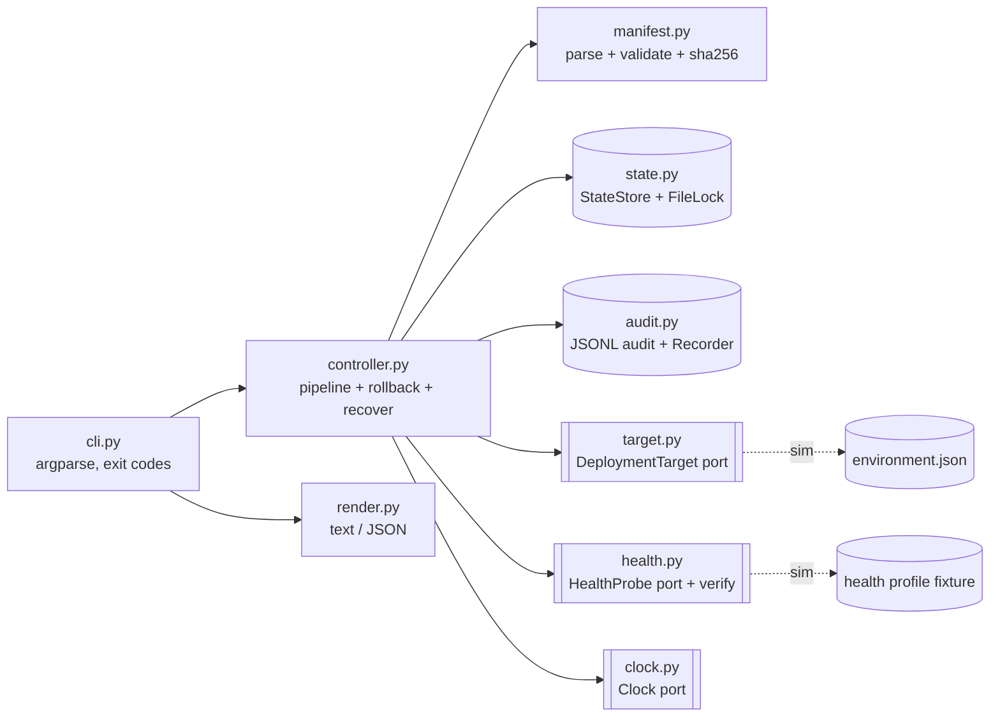
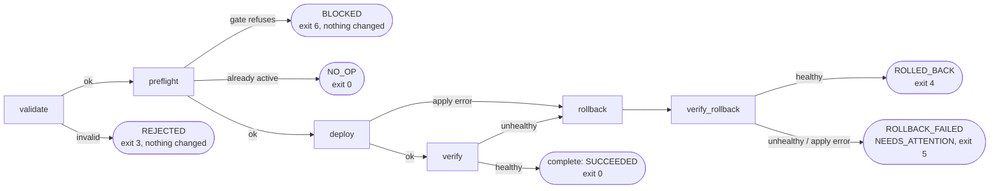
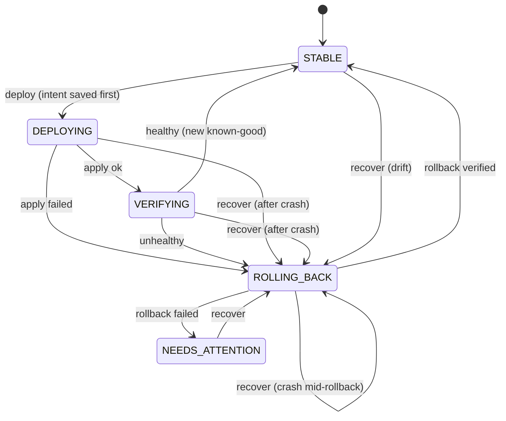

# safe-deploy-controller

`deployctl` is a command-line deployment controller. It takes a manifest for a versioned artifact, validates it, deploys it, and checks its health. If the health check fails, it rolls back to the last known-good version and checks that too.

Every run ends with the environment in a known state, and leaves an audit trail and a machine-readable result. A failed run, a retry, a crash or a concurrent run can't leave it ambiguous.

The target and the health checks are simulated with local files, so nothing real is deployed.

## Quick start

You need Python 3.11 or newer.

```bash
make install demo
```

`make demo` runs the scenario below against a throwaway state directory, `.demo-state/`.

To try it by hand:

```bash
source .venv/bin/activate

deployctl deploy --manifest examples/manifests/orders-api-1.4.2.json \
  --artifact-dir examples/artifacts --health-profile examples/health/default.json

deployctl status --service orders-api --env staging
deployctl history --service orders-api --env staging
```

## Problem and assumptions

The job is to change a running service safely: refuse bad input, stop when a release is unhealthy, put the previous version back without being asked, and leave a record that an auditor could follow. Retrying must always be safe.

The design assumes:

- **Simulated target.** `environment.json` stands in for the real system, and health results come from a fixture file. Both sit behind interfaces, so real adapters can replace them.
- **One controller host.** The lock is a local file, and the ledger and audit log are local files.
- **JSON manifests with strict semver.** Pre-release tags aren't supported.
- **Known-good is per environment.** A version proven in `staging` means nothing for `prod`.
- **A version means one artifact.** Artifacts are identified by sha256, so a rebuild needs a new version number.
- **One lock per state directory.** Unrelated deploys wait for each other. That's a simplification, not a requirement.

## Design



### One deploy



### Environment status

Each `service/environment` has a status in the ledger. The status is saved before the target is touched, so an interrupted run is always visible. Any transition not shown here is refused as a bug.



### Principles

| # | Principle | What it means here |
|---|---|---|
| P1 | Fail closed | An invalid manifest changes nothing. Missing health data counts as unhealthy. Unknown state blocks and asks a human. |
| P2 | Write-ahead state | Intent is saved before the target is touched, so any interruption can be seen and recovered. |
| P3 | Idempotent by construction | Re-running a finished deployment is a `NO_OP`. Re-running a failed version is `BLOCKED` unless overridden. |
| P4 | Few terminal states | Every run ends `STABLE` at a known version, or `NEEDS_ATTENTION`. An interrupted run stays in an explicit in-flight state until `recover`. |
| P5 | Automation knows when to stop | One automatic rollback. If that fails verification, it stops and asks for a human. |
| P6 | Ports and adapters | The target, health probe and clock are interfaces, so tests are fast and offline. |
| P7 | No runtime dependencies | Standard library only. The wheel, sdist and `.pyz` are the same bytes on every build of the same source. |

### Two sources of truth

`state.json` is the ledger: what the controller believes and intends. `environment.json` is the target: what is actually running. Preflight compares them, and a mismatch is **drift**, which blocks deploys until `recover` reconciles it. Keeping them apart is what lets the controller notice a change made behind its back.

## Usage

```text
deployctl --version
deployctl validate --manifest PATH --artifact-dir DIR
deployctl deploy   --manifest PATH --artifact-dir DIR --health-profile PATH
                   [--dry-run] [--allow-known-bad] [--allow-downgrade]
deployctl status   --service NAME --env ENV
deployctl recover  --service NAME --env ENV --reason TEXT --health-profile PATH
                   [--break-lock] [--actor NAME]
deployctl history  --service NAME --env ENV [--limit N]
```

Every command takes `--output {text,json}`. All but `validate` take `--state-dir DIR`, which defaults to `.deployctl` or `$DEPLOYCTL_STATE_DIR`.

- `validate` needs no state and writes nothing, so it can run in CI on every manifest change.
- `deploy` has no default health source. Without `--health-profile` it stops, rather than assume the release is healthy.
- `recover` needs a `--reason`, which goes in the audit log. `--actor` defaults to `$USER`.
- `status` exits 0 whenever it can report, including for `NEEDS_ATTENTION` and drift, so scripts should read its JSON.

[examples/manifests/orders-api-1.4.2.json](examples/manifests/orders-api-1.4.2.json) shows every manifest field, and [section 5.1 of the plan](docs/IMPLEMENTATION_PLAN.md#51-deployment-manifest-json) lists the validation rules.

### Exit codes

| Outcome | Exit | Meaning | Environment after |
|---|---|---|---|
| `SUCCEEDED` | 0 | New version verified and marked known-good | `STABLE` at the new version |
| `NO_OP` | 0 | Version already active, or `--dry-run` | unchanged |
| `RECOVERED` | 0 | `recover` restored the last known-good version | `STABLE` at known-good |
| `VALID` | 0 | `validate` found no problems | unchanged |
| none | 1 | Internal error or corrupt state | unchanged or explicit in-flight |
| none | 2 | Usage error, including a missing or bad `--health-profile` | unchanged |
| `REJECTED` | 3 | Manifest invalid, nothing touched | unchanged |
| `ROLLED_BACK` | 4 | Change failed, previous version restored and verified | `STABLE` at known-good |
| `ROLLBACK_FAILED` | 5 | Rollback failed. **Page a human**, then run `recover` | `NEEDS_ATTENTION` |
| `BLOCKED` | 6 | A preflight gate refused, or there is no ledger record for `recover` or `status` | unchanged |
| `INTERRUPTED` | 130 | SIGINT, SIGTERM or SIGHUP during a run | explicit in-flight |

Separate codes let a pipeline tell bad input from a bad release that's already mitigated, and both from a failure that needs a person now.

### What happens on a retry

| Situation when `deploy` runs | Behavior | Exit |
|---|---|---|
| Same version and artifact already active | `NO_OP`, audited, target not touched | 0 |
| Same version active with a different artifact | `BLOCKED`: release a new version | 6 |
| `STABLE` at another version | Normal pipeline | 0, 4 or 5 |
| Version previously failed verification here | `BLOCKED`. A successful `--allow-known-bad` deploy clears the mark | 6 |
| An earlier run crashed or was interrupted | `BLOCKED`: run `recover` | 6 |
| `NEEDS_ATTENTION` | `BLOCKED` until `recover` succeeds | 6 |
| Lock held by another run | `BLOCKED` with the owner and run ID. The lock isn't taken over | 6 |
| Drift between ledger and target | `BLOCKED`: run `recover` | 6 |
| Version lower than the active one | `BLOCKED` unless `--allow-downgrade` | 6 |

`recover` is safe to repeat too. With nothing to fix it's a `NO_OP`. With no ledger record it's `BLOCKED` and touches nothing, because an empty ledger, from a wrong `--state-dir` for example, says nothing about what's running.

When a rollback also fails, the cause is often the environment, such as a dependency outage, rather than the release. The failed version is still marked known-bad, so after investigating, `--allow-known-bad` may be the right way to deploy it again.

## Example output

`make demo` runs each of these against the same environment, in order. All the files are in [examples/](examples/).

| Step | Scenario | Outcome | Exit |
|---|---|---|---|
| 1 | First deploy of 1.4.2 | `SUCCEEDED` | 0 |
| 2 | The same manifest again | `NO_OP` | 0 |
| 3 | 1.5.0, which is unhealthy | `ROLLED_BACK` to 1.4.2 | 4 |
| 4 | 1.5.0 again | `BLOCKED`, known-bad | 6 |
| 5 | 1.5.1, flaky first and then healthy | `SUCCEEDED` | 0 |
| 6 | Manifest with several mistakes | `REJECTED`, listing all of them | 3 |
| 7 | Wrong checksum | `REJECTED` | 3 |
| 8 | Artifact path outside the artifact directory | `REJECTED` | 3 |
| 9 | 1.6.0 during a dependency outage | `ROLLBACK_FAILED`, `NEEDS_ATTENTION` | 5 |
| 10 | Any deploy while `NEEDS_ATTENTION` | `BLOCKED` | 6 |
| 11 | `recover`, once the outage is over | `RECOVERED` at 1.5.1 | 0 |

The demo ends with `status` and `history`. Step 6 isn't in that `history`, because its manifest declares the environment `qa`.

<details>
<summary>Full <code>make demo</code> output</summary>

```text
== 1. first deploy 1.4.2 (expect SUCCEEDED)
deployctl run r-20261031T124831-dbbfd1  key 9e326b3b733c
orders-api/staging  - -> 1.4.2  change CHG-1041  by catalin

   #  time (UTC)    stage            result  detail
   1  12:48:31.313  validate         PASS    manifest valid; sha256 verified
   2  12:48:31.314  preflight        PASS    STABLE @ nothing; lock acquired
   3  12:48:31.314  deploy           PASS    running version -> 1.4.2
   4  12:48:31.518  verify           PASS    3/3 consecutive healthy after 3 probes
   5  12:48:31.521  complete         PASS    1.4.2 is now known-good

OUTCOME SUCCEEDED   rollback NOT_NEEDED   env STABLE @ 1.4.2   exit 0
exit=0
== 2. same manifest again (expect NO_OP)
deployctl run r-20261031T124831-78e85b  key 9e326b3b733c
orders-api/staging  1.4.2 -> 1.4.2  change CHG-1041  by catalin

   #  time (UTC)    stage            result  detail
   1  12:48:31.611  validate         PASS    manifest valid; sha256 verified
   2  12:48:31.612  preflight        SKIP    1.4.2 already active

OUTCOME NO_OP   rollback NOT_NEEDED   env STABLE @ 1.4.2   exit 0
exit=0
== 3. unhealthy 1.5.0 (expect ROLLED_BACK to 1.4.2)
deployctl run r-20261031T124831-5eec78  key 08618223315f
orders-api/staging  1.4.2 -> 1.5.0  change CHG-1042  by catalin

   #  time (UTC)    stage            result  detail
   1  12:48:31.680  validate         PASS    manifest valid; sha256 verified
   2  12:48:31.681  preflight        PASS    STABLE @ 1.4.2; lock acquired
   3  12:48:31.681  deploy           PASS    running version -> 1.5.0
   4  12:48:31.893  verify           FAIL    0/3 consecutive healthy after 3 probes (error_rate 0.120 > 0.010)
   5  12:48:31.897  rollback         PASS    running version -> 1.4.2
   6  12:48:32.108  verify_rollback  PASS    3/3 consecutive healthy after 3 probes

OUTCOME ROLLED_BACK   rollback SUCCEEDED   env STABLE @ 1.4.2   exit 4
NEXT    1.5.0 is marked known-bad for orders-api/staging; investigate before retrying with --allow-known-bad
exit=4
== 4. retry 1.5.0 (expect BLOCKED known-bad)
deployctl run r-20261031T124832-2f57bd  key 08618223315f
orders-api/staging  1.4.2 -> 1.5.0  change CHG-1042  by catalin

   #  time (UTC)    stage            result  detail
   1  12:48:32.207  validate         PASS    manifest valid; sha256 verified
   2  12:48:32.208  preflight        FAIL    1.5.0 previously failed verification here

OUTCOME BLOCKED   rollback NOT_NEEDED   env STABLE @ 1.4.2   exit 6
NEXT    investigate, then retry with --allow-known-bad
exit=6
== 5. flaky-then-healthy 1.5.1 (expect SUCCEEDED)
deployctl run r-20261031T124832-2e12ff  key f40fb9ddf4c9
orders-api/staging  1.4.2 -> 1.5.1  change CHG-1043  by catalin

   #  time (UTC)    stage            result  detail
   1  12:48:32.275  validate         PASS    manifest valid; sha256 verified
   2  12:48:32.295  preflight        PASS    STABLE @ 1.4.2; lock acquired
   3  12:48:32.296  deploy           PASS    running version -> 1.5.1
   4  12:48:32.612  verify           PASS    3/3 consecutive healthy after 4 probes
   5  12:48:32.617  complete         PASS    1.5.1 is now known-good

OUTCOME SUCCEEDED   rollback NOT_NEEDED   env STABLE @ 1.5.1   exit 0
exit=0
== 6. invalid manifest (expect REJECTED)
deployctl run r-20261031T124832-d6e4ac  key -
orders-api/qa  - -> -  change -  by -

   #  time (UTC)    stage            result  detail
   1  12:48:32.712  validate         FAIL    manifest: unknown key 'verison'; environment: 'qa' must be one of dev, staging, prod; version: '1.5' must be MAJOR.MINOR.PATCH; artifact.sha256: required; change_id: '1042' must be CHG-<3+ digits>; requested_by: required

OUTCOME REJECTED   rollback NOT_NEEDED   env not read   exit 3
NEXT    fix the manifest; nothing changed
exit=3
== 7. checksum mismatch (expect REJECTED)
deployctl run r-20261031T124832-103197  key -
orders-api/staging  - -> -  change -  by -

   #  time (UTC)    stage            result  detail
   1  12:48:32.780  validate         FAIL    artifact.sha256: mismatch, declared 0000000000000000000000000000000000000000000000000000000000000000, file has 2b0e7c540710f0de3e8c6a1b091fb21dfcb9874c149ae9fb43c9ba2b0b47b2d5

OUTCOME REJECTED   rollback NOT_NEEDED   env not read   exit 3
NEXT    fix the manifest; nothing changed
exit=3
== 8. path traversal (expect REJECTED)
deployctl run r-20261031T124832-d155f9  key -
orders-api/staging  - -> -  change -  by -

   #  time (UTC)    stage            result  detail
   1  12:48:32.845  validate         FAIL    artifact.path: '../../etc/hosts' escapes the artifact directory

OUTCOME REJECTED   rollback NOT_NEEDED   env not read   exit 3
NEXT    fix the manifest; nothing changed
exit=3
== 9. 1.6.0 during dependency outage (expect ROLLBACK_FAILED / NEEDS_ATTENTION)
deployctl run r-20261031T124832-23e38a  key 8dfd3deddaf0
orders-api/staging  1.5.1 -> 1.6.0  change CHG-1044  by catalin

   #  time (UTC)    stage            result  detail
   1  12:48:32.912  validate         PASS    manifest valid; sha256 verified
   2  12:48:32.913  preflight        PASS    STABLE @ 1.5.1; lock acquired
   3  12:48:32.914  deploy           PASS    running version -> 1.6.0
   4  12:48:33.122  verify           FAIL    0/3 consecutive healthy after 3 probes (error_rate 0.450 > 0.010)
   5  12:48:33.125  rollback         PASS    running version -> 1.5.1
   6  12:48:33.337  verify_rollback  FAIL    0/3 consecutive healthy after 3 probes (error_rate 0.450 > 0.010)

OUTCOME ROLLBACK_FAILED   rollback FAILED   env NEEDS_ATTENTION @ 1.5.1   exit 5
NEXT    page a human; once the cause is fixed, run `deployctl recover`
exit=5
== 10. deploy while NEEDS_ATTENTION (expect BLOCKED)
deployctl run r-20261031T124833-e67fe9  key f40fb9ddf4c9
orders-api/staging  1.5.1 -> 1.5.1  change CHG-1043  by catalin

   #  time (UTC)    stage            result  detail
   1  12:48:33.420  validate         PASS    manifest valid; sha256 verified
   2  12:48:33.421  preflight        FAIL    orders-api/staging is NEEDS_ATTENTION: run r-20261031T124832-23e38a at stage verify_rollback

OUTCOME BLOCKED   rollback NOT_NEEDED   env NEEDS_ATTENTION @ 1.5.1   exit 6
NEXT    run `deployctl recover`
exit=6
== 11. operator recovers after outage (expect RECOVERED @ 1.5.1)
deployctl run r-20261031T124833-d26dac  key 8dfd3deddaf0
orders-api/staging  1.5.1 -> 1.5.1  change -  by oncall

   #  time (UTC)    stage            result  detail
   1  12:48:33.489  recover          PASS    NEEDS_ATTENTION, running 1.5.1, restoring 1.5.1; reason: outage over
   2  12:48:33.490  rollback         PASS    running version -> 1.5.1
   3  12:48:33.805  verify_rollback  PASS    3/3 consecutive healthy after 4 probes

OUTCOME RECOVERED   rollback SUCCEEDED   env STABLE @ 1.5.1   exit 0
exit=0
orders-api/staging  STABLE
  running     1.5.1
  active      1.5.1
  known-good  1.5.1
  known-bad   1.5.0, 1.6.0
  drift       no
  in flight   -
  updated     2026-10-31T12:48:33.806Z
  last run    r-20261031T124833-d26dac
orders-api/staging: latest 10 runs, newest first

started (UTC)             run                       versions        change    actor    outcome
2026-10-31T12:48:33.489Z  r-20261031T124833-d26dac  1.5.1 -> 1.5.1  -         oncall   RECOVERED
2026-10-31T12:48:33.420Z  r-20261031T124833-e67fe9  1.5.1 -> 1.5.1  CHG-1043  catalin  BLOCKED
2026-10-31T12:48:32.912Z  r-20261031T124832-23e38a  1.5.1 -> 1.6.0  CHG-1044  catalin  ROLLBACK_FAILED
2026-10-31T12:48:32.845Z  r-20261031T124832-d155f9  - -> -          -         -        REJECTED
2026-10-31T12:48:32.780Z  r-20261031T124832-103197  - -> -          -         -        REJECTED
2026-10-31T12:48:32.275Z  r-20261031T124832-2e12ff  1.4.2 -> 1.5.1  CHG-1043  catalin  SUCCEEDED
2026-10-31T12:48:32.207Z  r-20261031T124832-2f57bd  1.4.2 -> 1.5.0  CHG-1042  catalin  BLOCKED
2026-10-31T12:48:31.680Z  r-20261031T124831-5eec78  1.4.2 -> 1.5.0  CHG-1042  catalin  ROLLED_BACK
2026-10-31T12:48:31.611Z  r-20261031T124831-78e85b  1.4.2 -> 1.4.2  CHG-1041  catalin  NO_OP
2026-10-31T12:48:31.313Z  r-20261031T124831-dbbfd1  - -> 1.4.2      CHG-1041  catalin  SUCCEEDED
```

</details>

### JSON result

With `--output json`, stdout carries only JSON. This is step 3 again, from a fresh state directory:

```bash
deployctl deploy --manifest examples/manifests/orders-api-1.5.0.json \
  --artifact-dir examples/artifacts --health-profile examples/health/default.json \
  --output json
```

```json
{
  "run_id": "r-20261031T124856-6f7ee1",
  "outcome": "ROLLED_BACK",
  "rollback_status": "SUCCEEDED",
  "deployment_key": "08618223315f",
  "service": "orders-api",
  "environment": "staging",
  "change_id": "CHG-1042",
  "actor": "catalin",
  "from_version": "1.4.2",
  "to_version": "1.5.0",
  "final_state": {
    "status": "STABLE",
    "active_version": "1.4.2"
  },
  "next_action": "1.5.0 is marked known-bad for orders-api/staging; investigate before retrying with --allow-known-bad",
  "steps": [
    {
      "seq": 1,
      "ts": "2026-10-31T12:48:56.508Z",
      "stage": "validate",
      "result": "PASS",
      "message": "manifest valid; sha256 verified"
    },
    {
      "seq": 2,
      "ts": "2026-10-31T12:48:56.509Z",
      "stage": "preflight",
      "result": "PASS",
      "message": "STABLE @ 1.4.2; lock acquired"
    },
    {
      "seq": 3,
      "ts": "2026-10-31T12:48:56.510Z",
      "stage": "deploy",
      "result": "PASS",
      "message": "running version -> 1.5.0"
    },
    {
      "seq": 4,
      "ts": "2026-10-31T12:48:56.720Z",
      "stage": "verify",
      "result": "FAIL",
      "message": "0/3 consecutive healthy after 3 probes (error_rate 0.120 > 0.010)"
    },
    {
      "seq": 5,
      "ts": "2026-10-31T12:48:56.724Z",
      "stage": "rollback",
      "result": "PASS",
      "message": "running version -> 1.4.2"
    },
    {
      "seq": 6,
      "ts": "2026-10-31T12:48:56.938Z",
      "stage": "verify_rollback",
      "result": "PASS",
      "message": "3/3 consecutive healthy after 3 probes"
    }
  ],
  "exit_code": 4
}
```

## Testing

```bash
make test    # all tests, with a 90% branch coverage gate
make lint    # format check, ruff, and mypy in strict mode
```

There are 577 tests, at 100% branch coverage. They use a fake clock, so they don't really sleep, apart from the tests that run real processes.

| Requirement | Tests |
|---|---|
| Successful deployment | [tests/scenarios/test_deploy_success.py](tests/scenarios/test_deploy_success.py) |
| Invalid input, proving state and target stay byte-identical | [tests/scenarios/test_invalid_input.py](tests/scenarios/test_invalid_input.py), [tests/unit/test_manifest.py](tests/unit/test_manifest.py) |
| Failed health check and rollback | [tests/scenarios/test_failed_health.py](tests/scenarios/test_failed_health.py), [tests/unit/test_health.py](tests/unit/test_health.py) |
| Repeated execution | [tests/scenarios/test_repeated_execution.py](tests/scenarios/test_repeated_execution.py) |
| Crashes and `recover` | [tests/scenarios/test_crash_recovery.py](tests/scenarios/test_crash_recovery.py) |
| Locking | [tests/scenarios/test_locking.py](tests/scenarios/test_locking.py) |
| Full demo sequence | [tests/scenarios/test_demo_sequence.py](tests/scenarios/test_demo_sequence.py) |
| CLI, JSON contract, and stop signals sent to a real process | [tests/cli/test_cli.py](tests/cli/test_cli.py) |
| The built `.pyz`: exit codes, stdlib only, same bytes each build | [tests/cli/test_zipapp_smoke.py](tests/cli/test_zipapp_smoke.py) |

The crash tests matter most. They stop a run at each dangerous point (after intent is saved, after `apply`, mid-verify, mid-rollback) with an exception that gets past `except Exception`, as a hard kill would. Each time the ledger must show an explicit in-flight state, `deploy` must refuse, and `recover` must bring the environment back to `STABLE` with the running, active and known-good versions agreeing. That is the evidence for the claim that a crash can't leave the environment ambiguous.

Coverage alone wasn't trusted. In most phases, deliberate bugs were injected into a throwaway copy to confirm that the tests fail when the code is wrong. [AI_PROCESS.md](AI_PROCESS.md) has the results.

## Build and packaging

```bash
make ci             # lint, test, build and smoke test: what CI runs
make build          # wheel, sdist and .pyz into dist/
make dist-tarball   # ../safe-deploy-controller.tar.gz, from HEAD
```

`make build` writes three artifacts to `dist/`:

| Artifact | How to run it |
|---|---|
| `deployctl.pyz` | `python3 dist/deployctl.pyz --version`. One file, Python 3.11 or newer, nothing to install |
| `safe_deploy_controller-*.whl` | `pip install` it, then run `deployctl` |
| `safe_deploy_controller-*.tar.gz` | The sdist, for building from source |

The same source gives byte-identical artifacts. Hatchling takes care of the wheel and sdist, and [scripts/build_zipapp.py](scripts/build_zipapp.py) takes care of the `.pyz`, with fixed timestamps and sorted entries. Its entries are stored rather than compressed, so the bytes don't depend on Python's zlib.

Dev tools are pinned in `requirements-dev.txt`, which `make lock` regenerates. `hatchling` is pinned in `pyproject.toml`. The version number lives only in [src/deployctl/\_\_init\_\_.py](src/deployctl/__init__.py).

## CI/CD and production controls

**Built today.** [.github/workflows/ci.yml](.github/workflows/ci.yml) runs `make ci` on Python 3.11, 3.12 and 3.13 for every pull request and every push to `main`, then keeps the `dist/` from Python 3.12. The token is read-only, and actions are pinned to commit SHAs.

Inside `deployctl`, these controls also exist already: a `change_id` on every manifest, sha256 checks before anything changes, a known-bad gate, a downgrade gate, automated health gates with automatic rollback, fail-closed handling of missing metrics, and an append-only audit log.

**Everything below is proposed.** None of it is built. It's what a real rollout would add around this controller.

- **CI pipeline.** After the steps above: sign the artifact with Sigstore or cosign, generate an SBOM, attach SLSA provenance, and publish an immutable artifact by digest. Run `deployctl validate` on every manifest pull request.
- **Approvals.** Link every change to a change record. Require a `prod` approver who isn't the requester, record approvals in the audit trail, and enforce this with CI/CD environment protection rules.
- **Change windows.** Enforce a freeze calendar as a preflight gate. An emergency override needs an incident ID, and is audited and alerted on.
- **Progressive delivery.** Go canary 1%, 10%, 50%, 100% with bake time and automated analysis at each step, or blue/green with an instant traffic switch. Use feature flags to separate deploy from release. Promote dev, then staging, then prod, requiring the version to be proven in the previous environment.
- **Observability gates.** Compare canary against baseline on error rate, p99 latency and saturation. Add an SLO burn-rate check and synthetic checks. Require enough traffic for a meaningful decision, treat missing metrics as failure, annotate dashboards with deploy events, and roll back on burn.
- **Access controls.** Least privilege, a deployer identity from short-lived OIDC credentials rather than long-lived secrets, separation of duties, signatures verified before `apply`, and the audit log shipped to tamper-evident storage.
- **Making the controller itself production-grade.** Replace the lockfile with a distributed lease and fencing token (etcd, Consul or DynamoDB conditional writes). Move state to a durable store with optimistic concurrency. Add real adapters behind the existing `DeploymentTarget` and `HealthProbe` ports, such as Kubernetes or Argo CD and Prometheus or Datadog. Send `NEEDS_ATTENTION` to chat or paging, and publish metrics on deploy outcomes, such as change failure rate and time to restore.

## Known limitations

- **Simulated only.** There are no real `DeploymentTarget` or `HealthProbe` adapters and no real artifact store.
- **Single host.** The lockfile doesn't work across hosts, and the ledger and audit log are local files.
- **Global lock.** It's held through the rollout wait, for up to twice `rollout_timeout_seconds` when a deploy also rolls back.
- **Actor.** A deploy's `actor` is the manifest's self-declared `requested_by`, not who ran it.
- **Thresholds.** Rollback verification reuses the new manifest's thresholds, and `recover` after drift uses the defaults.
- **Versions.** There's no pre-release semver.
- **After a crash.** A run can't resume from its last stage. `recover` rolls back instead.
- **No traffic.** A service with no traffic can produce NaN, fail verification and be marked known-bad.
- **Lost `state.json`.** `recover` can't fix this, because it refuses an environment with no record. The file must be restored by hand.
- **Corrupt `environment.json`.** This blocks every environment until it's repaired by hand, as described below.
- **Refused bad profiles.** A deploy refused for a bad health profile exits 2 and leaves no audit record.
- **Build inputs.** `hatchling`'s own dependencies aren't pinned. The action SHAs are updated by hand.

### Repairing a corrupt `environment.json`

The controller refuses a corrupt `environment.json`: `deploy`, `status` and `recover` all exit 1 and leave the file alone. Treating it as empty could erase other environments' records, and rebuilding it from the ledger would defeat drift detection. So a person has to repair it.

1. Copy the file aside and inspect it.
2. Repair it if the correct content is clear. It maps each `service/environment` to its running version:

   ```json
   {
     "orders-api/staging": {
       "running_version": "1.5.1",
       "updated_at": "2026-11-01T17:49:02.191Z"
     }
   }
   ```

   Otherwise delete it. Deleting affects every environment: each one then reads as nothing running, which is drift, so each needs its own `recover`.
3. Run `recover` for each affected environment:

   ```bash
   deployctl recover --service NAME --env ENV --reason TEXT --health-profile PATH
   ```

   The hand edit itself isn't audited, so `--reason` should say what was changed.

If the repaired file matches the ledger, `recover` is a `NO_OP` that still records the reason. If not, it restores the last known-good version and verifies it, using the default health thresholds, because drift has no failed deploy to take them from.

## Time spent

Working time wasn't tracked directly. Commit and PR timestamps give an upper bound of about 8 hours elapsed, including breaks, against the roughly 2 hours the exercise suggests. The extra time went on the optional safety work, on reviewing each phase, and on bug-injection checks. [docs/ai-log.md](docs/ai-log.md) has the breakdown.

With another day, the next work would be, in order:

1. Real `DeploymentTarget` and `HealthProbe` adapters.
2. A lock that works across hosts, and durable state.
3. A separate "inconclusive" verification result, so that a service with no traffic isn't marked known-bad.
4. An audited way to repair a corrupt `environment.json`, in place of the hand repair.
5. Audit records for deploys refused by a bad health profile.
6. The stretch items: promotion gates between environments, a change-window policy, two-person approval for `prod`, and canary steps.
