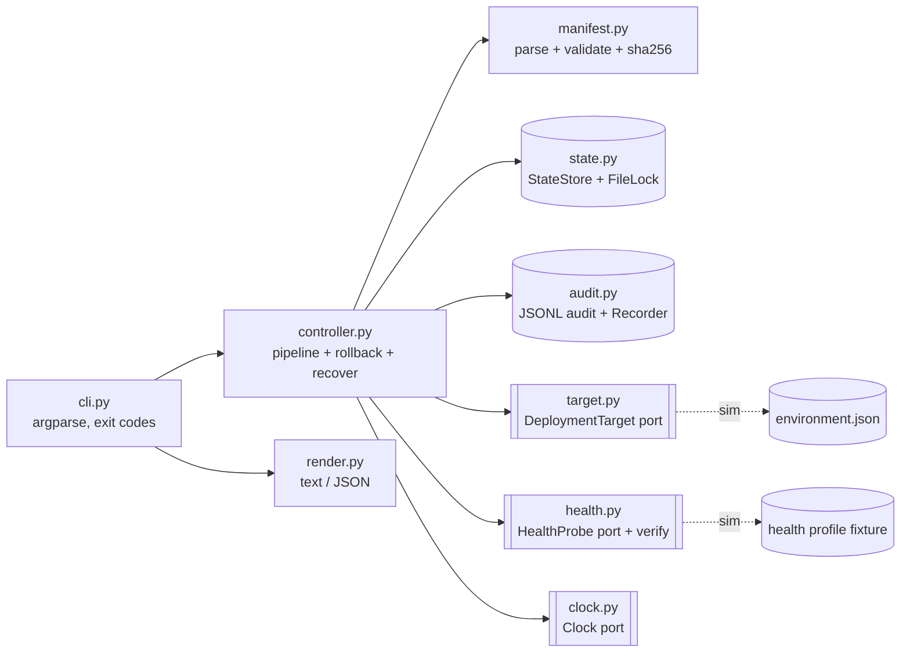
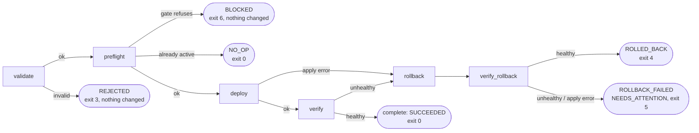
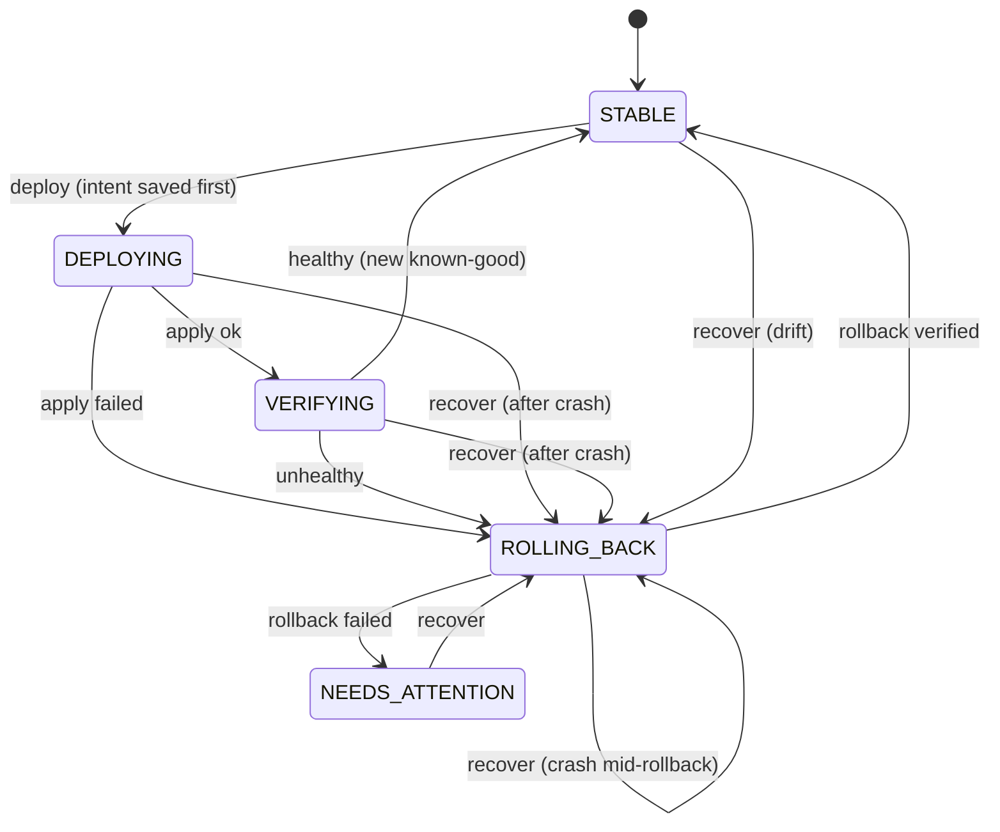

# Implementation Plan: Option 4, Safe Deployment and Rollback Controller (Python)

> Working name: **`deployctl`**, repo **`safe-deploy-controller`**, Python **3.11+**, **stdlib-only runtime**.
> Source: *EOC SRE Engineer Take-Home Exercises v1.0*, Option 4.
> Status, changes since the original plan, open items and decisions waiting for review: section 16.

---

## 0. How to use this plan

1. Create the repo and drop this file in as `docs/IMPLEMENTATION_PLAN.md` (first commit). It is AI-generated, so reference it in `AI_PROCESS.md`.
2. Work **phase by phase** (section 10). Each phase ends with `make lint test` green and a commit.
3. If you use an AI assistant in VS Code, give it **one phase at a time** plus the relevant contract sections (4, 5, 8), and ask for tests alongside code.
4. Keep a scratch log (`docs/ai-log.md`, gitignored or committed) of prompts, accepted/rejected suggestions, and time per phase. You need it for `AI_PROCESS.md` and the time note.

**Time budget:** the core plan is roughly 2.5 to 3 hours. The PDF suggests about 2 hours. If you want to hold to 2 hours, use the cut line in section 2.

### First 10 minutes (macOS, VS Code)

```bash
python3 --version                      # need >= 3.11 (brew install python@3.12 if not)
mkdir safe-deploy-controller && cd safe-deploy-controller
git init -b main
mkdir -p docs src/deployctl tests examples/{artifacts,manifests,health} .vscode .github/workflows
cp ~/Downloads/IMPLEMENTATION_PLAN.md docs/
echo "# safe-deploy-controller" > README.md                 # pyproject references it; build fails without it
echo '__version__ = "0.1.0"' > src/deployctl/__init__.py   # hatchling needs the package to exist
code .
# create pyproject.toml + Makefile from section 9, then:
python3 -m venv .venv && source .venv/bin/activate
pip install --upgrade pip && pip install -e '.[dev]'
pip freeze --exclude-editable > requirements-dev.txt   # pinned, reproducible dev deps
make lint test
git add -A && git commit -m "chore: scaffold project with build/test tooling"
```

---

## 1. Goal and guiding principles

**Interpretation.** Build a local CLI controller that takes a deployment manifest for a versioned artifact and drives it through `validate → preflight → deploy → verify → complete` against a **simulated environment**. If verification fails, it **automatically rolls back** to the last known-good version and verifies the rollback. All state is persisted so that a retry, a crash, or a concurrent run never leaves the environment ambiguous, and every run produces an **audit trail** plus a machine-readable result.

**Principles to design and defend around:**

| # | Principle | What it means in code |
|---|---|---|
| P1 | **Fail closed** | Invalid manifest → no change. Missing or unknown health data → unhealthy. Unknown state → block and ask a human. |
| P2 | **Write-ahead state** | Persist *intent* (`DEPLOYING`, `in_flight`) **before** touching the target, so any interruption is visible and recoverable. |
| P3 | **Idempotent by construction** | Re-running a completed deployment is a `NO_OP`. Re-running a version that failed is `BLOCKED` unless explicitly overridden. |
| P4 | **Small set of terminal states** | Every run ends with the environment `STABLE` (at a known version) or `NEEDS_ATTENTION` (human required). Never "unknown". |
| P5 | **Automation knows when to stop** | One automatic rollback attempt. If the rollback also fails verification, stop and page; do not flap. |
| P6 | **Ports and adapters** | Health probe, deployment target, state store, and clock are interfaces. Simulated now, real later; tests are fast and offline. |
| P7 | **Zero runtime dependencies** | Stdlib only (argparse, json, dataclasses, hashlib). Wheel and single-file `.pyz` are trivially reproducible. |

---

## 2. Scope

| Priority | Item |
|---|---|
| **Must** (PDF requirements) | Manifest validation incl. sha256; state + audit; simulated deploy; health verification; stop on failure; auto rollback to last known-good; idempotent re-runs; audit-friendly result (text + JSON); tests for success / invalid input / failed health / repeated execution; Makefile build/test/package; CI workflow; README; AI_PROCESS.md |
| **Should** (cheap, shows judgment) | Lock against concurrent runs; crash/interrupt handling + `recover` command; drift detection (recorded vs running version); block re-deploy of known-bad versions; downgrade guard; `status` and `history` commands; `--dry-run`; documented exit codes |
| **Stretch** | Environment promotion gate (prod requires version proven in staging); change-window policy with emergency override; two-person approval for prod; canary steps (10/50/100%); property-based tests (Hypothesis); Dockerfile; manual `rollback` command |

**2-hour cut line:** keep all *Must* items plus lock, `recover`, and known-bad blocking. Drop `history`, drift detection, downgrade guard, and `.pyz` (wheel alone is a runnable artifact). List what you cut under "What I'd do with another day".

---

## 3. Architecture



| Module | Responsibility | Side effects |
|---|---|---|
| `models.py` | Enums and dataclasses: `Manifest`, `HealthCheckSpec`, `EnvironmentState`, `InFlight`, `StepRecord`, `DeploymentResult` | none |
| `errors.py` | Exception hierarchy (`ManifestError`, `LockHeld`, `StateCorruptError`, `ProbeTimeout`, ...) | none |
| `manifest.py` | `load_manifest(path, artifact_dir)`: strict schema, collects **all** errors, path-traversal check, streamed sha256 | reads files |
| `fileio.py` | `write_atomic(path, content)`: tmp file, fsync, rename, directory fsync. Shared by `state.py` and `target.py` | writes files |
| `state.py` | `StateStore` (atomic JSON writes, schema version), `FileLock` (O_CREAT/O_EXCL lockfile with owner metadata), `ALLOWED_TRANSITIONS` | writes state dir |
| `audit.py` | `AuditLog` (append-only JSONL, fsync per event), `Recorder` (seq numbers, timestamps, step list, builds result) | appends audit file |
| `target.py` | `DeploymentTarget` protocol; `SimulatedTarget` persisting "running version" per env in `environment.json` | writes target file |
| `health.py` | `HealthProbe` protocol; `FixtureHealthProbe`; pure `verify()` gating logic | reads fixture |
| `clock.py` | `Clock` protocol, `SystemClock` (tests use `FakeClock`, no real sleeps) | sleeps |
| `controller.py` | Orchestration: validate, preflight gates, write-ahead transitions, deploy, verify, rollback, recover | via ports only |
| `render.py` | Human-readable table and JSON output | stdout |
| `cli.py` | argparse wiring, adapter construction, exit codes, `main(argv) -> int`, `run()` | process exit |

**Two sources of truth, deliberately.** `state.json` is the controller's *ledger* (what it believes and intends). `environment.json` is the simulated *target* (what is actually running). Preflight compares them; a mismatch is **drift** and blocks deploys until `recover` reconciles. This mirrors desired-vs-actual reconciliation in real systems and is a good interview talking point.

---

## 4. Deployment lifecycle and safety rules

### 4.1 Pipeline stages (one `deploy` run)



### 4.2 Environment status (persisted per `service/environment`)



Enforce this with an explicit `ALLOWED_TRANSITIONS` table; an illegal transition raises `InvariantError` (a bug, exit 1). Unit-test the table.

### 4.3 Outcomes and exit codes (document in README)

| Outcome | Exit | Meaning | Environment after |
|---|---|---|---|
| `SUCCEEDED` | 0 | New version verified and marked known-good | `STABLE @ new` |
| `NO_OP` | 0 | Requested version already active (or `--dry-run`) | unchanged |
| `RECOVERED` | 0 | `recover` restored last known-good | `STABLE @ lkg` |
| `VALID` | 0 | `validate` found no problems; it writes nothing | unchanged |
| — | 1 | Internal error / corrupt state (bug or disk issue) | unchanged or explicit in-flight |
| — | 2 | CLI usage error (argparse), including a missing or bad `--health-profile`, or a bad `--service` or `--env` | unchanged |
| `REJECTED` | 3 | Manifest invalid; nothing was touched | unchanged |
| `ROLLED_BACK` | 4 | Change failed; previous known-good restored and verified | `STABLE @ lkg` |
| `ROLLBACK_FAILED` | 5 | Rollback failed; **page a human**, run `recover` | `NEEDS_ATTENTION` |
| `BLOCKED` | 6 | Preflight gate refused (lock, in-flight, drift, known-bad, downgrade), or no ledger record for `recover` or `status` | unchanged |
| `INTERRUPTED` | 130 | SIGINT, SIGTERM or SIGHUP during a run; in-flight state left explicit | explicit in-flight |

Rationale: distinct codes let CI/CD branch on "bad input" vs "bad release, already mitigated" vs "humans needed now".

### 4.4 Repeated execution and retry matrix (this is the "safe to retry" requirement)

| Situation when `deploy` is (re)run | Behavior | Exit |
|---|---|---|
| Env `STABLE`, running = recorded = requested version, same artifact sha | `NO_OP`, audit records it, target **not** touched | 0 |
| Requested version is active but the artifact sha differs (a rebuild) | `BLOCKED`: "already active with a different artifact; release a new version" | 6 |
| Env `STABLE` at another version | Normal pipeline | 0 / 4 / 5 |
| Requested version is in `failed_versions` for this env | `BLOCKED`: "previously failed verification; use `--allow-known-bad`". A successful `--allow-known-bad` deploy removes the mark | 6 |
| Previous run crashed/interrupted (`DEPLOYING`/`VERIFYING`/`ROLLING_BACK` persisted) | `BLOCKED`: "in-flight run `<id>` at stage `<x>`; run `deployctl recover`" | 6 |
| Env `NEEDS_ATTENTION` | `BLOCKED` until `recover` succeeds | 6 |
| Lock held by another run | `BLOCKED` with owner/run id/since; lock not stolen | 6 |
| Drift: running version ≠ recorded active version | `BLOCKED`: run `recover` to reconcile | 6 |
| Requested version < active (semver) | `BLOCKED` unless `--allow-downgrade` (rollback is the path for going back) | 6 |
| `recover` when already `STABLE` and no drift | `NO_OP` (recover is idempotent too) | 0 |
| `recover` with no ledger record for the environment | `BLOCKED`: nothing touched, because an empty ledger says nothing about what is running | 6 |

### 4.5 Failure handling rules

- **Validation runs before the lock and before reading state.** A rejected manifest must leave `state.json` and `environment.json` byte-identical (assert this in tests).
- **Adapter exception during `apply`** (an `Exception`): the env may be half-changed, so treat it as a failed deploy and roll back. The version is not marked known-bad, because its health was never measured.
- **Known-bad marks:** a version is marked only if at least one probe reached it. A stalled rollout, a failed `apply`, a crash or a version overwritten during verification all roll back without a mark. Probe timeouts and "no data" do mark it, failing closed. `recover` never marks anything.
- **Probe timeout/error during verify:** counts as a failed probe (fail closed); verification continues until it passes or cannot pass.
- **Rollout not finished within `rollout_timeout_seconds`:** verification fails with no probes run, and the normal rollback follows. The wait uses no health attempts, and the lock stays held throughout.
- **Unexpected exception after `DEPLOYING` was saved:** best-effort rollback. An error while verifying the rollback, such as an unreadable target, is a failed rollback: `NEEDS_ATTENTION`, exit 5. If the ledger or audit log can't be written, leave the explicit in-flight state and raise `RecoveryRequired`, which carries the `recover` instruction and exits 1.
- **SIGINT, SIGTERM, SIGHUP / hard kill:** do **not** take more automated actions after being told to stop. In-flight state is already persisted (write-ahead); exit 130 with the `recover` instruction. The lock is released in `finally`; a SIGKILL leaves a stale lockfile that `recover --break-lock` clears (recorded in audit).
- **Corrupt or unknown-schema `state.json`, or corrupt `environment.json`:** refuse to run (exit 1) and **never overwrite it**; the operator must inspect it.
- **First-ever deploy fails** (no previous known-good): rollback means removing the bad version. The env ends `STABLE` with nothing running, `rollback_status = NO_PREVIOUS_VERSION`.
- **Rollback verification fails:** mark `NEEDS_ATTENTION`, exit 5, no further automatic actions. A version with a measured failure is still recorded as failed, conservatively. Note in the README that when the rollback also fails, the root cause is likely environmental (e.g. a dependency outage), so the operator may legitimately use `--allow-known-bad` later.

---

## 5. Data contracts

### 5.1 Deployment manifest (JSON)

```json
{
  "service": "orders-api",
  "environment": "staging",
  "version": "1.5.0",
  "artifact": {
    "path": "orders-api-1.5.0.bin",
    "sha256": "<64 hex chars>"
  },
  "change_id": "CHG-1042",
  "requested_by": "catalin",
  "health_check": {
    "attempts": 5,
    "required_consecutive": 3,
    "interval_seconds": 0.1,
    "timeout_seconds": 2,
    "max_error_rate": 0.01,
    "max_p99_latency_ms": 500,
    "rollout_timeout_seconds": 30
  }
}
```

**Validation rules** (collect *all* errors, then report them together):

| Field | Rule |
|---|---|
| top level | valid JSON object; **unknown keys rejected** (catches typos like `verison`) |
| `service` | required; `^[a-z][a-z0-9-]{1,40}$` |
| `environment` | required; one of `dev`, `staging`, `prod` |
| `version` | required; strict `MAJOR.MINOR.PATCH` (pre-release tags out of scope, documented) |
| `artifact.path` | required; resolved **inside** `--artifact-dir` (reject `../` traversal and absolute paths); file must exist |
| `artifact.sha256` | required; 64 lowercase hex; must equal the streamed sha256 of the file |
| `change_id` | required; `^CHG-\d{3,}$` (links every change to a change record) |
| `requested_by` | required; non-empty |
| `health_check` | optional (defaults); `1 ≤ required_consecutive ≤ attempts ≤ 20`; `0 ≤ max_error_rate ≤ 1`; `max_p99_latency_ms > 0`; `0 < timeout_seconds ≤ 30`; `0 ≤ interval_seconds ≤ 60`; `0 ≤ rollout_timeout_seconds ≤ 3600` |

**Idempotency key:** `deployment_key = sha256("service|environment|version|artifact_sha256|change_id")[:12]`. Each invocation also gets a unique `run_id` (injected factory; deterministic in tests). Both go into every audit event.

### 5.2 Simulated health profile (fixture)

```json
{
  "orders-api": {
    "1.4.2": [{"error_rate": 0.002, "p99_latency_ms": 180}],
    "1.5.0": [{"error_rate": 0.120, "p99_latency_ms": 950}],
    "1.5.1": ["timeout", {"error_rate": 0.004, "p99_latency_ms": 240}],
    "1.6.0": [{"error_rate": 0.003, "p99_latency_ms": 200}]
  }
}
```

- Each list is the sequence of probe responses for that version; **the last entry repeats**.
- `"timeout"` raises `ProbeTimeout`; `"error"` raises `ProbeError`. Both count as failed probes.
- A service/version that is not listed returns "no data", which is **unhealthy** (P1).
- An entry may leave out a metric or set it to `null`, which is how a fixture expresses a missing metric.
- The profile is checked when loaded, including service and version keys, which follow the manifest rules. A malformed one raises `HealthProfileError` before the target is touched, so a formatting mistake such as `1.6.O` can't cause a false rollback. A valid but wrong key, such as `1.6.1` for `1.6.0`, can't be detected, and that version reads as "no data".
- The position in a sequence is kept per environment and version, in memory, so each process starts from the first entry.
- `examples/health/dependency-outage.json` makes every version unhealthy, which is used to demo a failed rollback.

**Verify algorithm** (pure function, `FakeClock` in tests):

```
poll target.running_version once a second until it == expected
    not there after rollout_timeout_seconds: FAIL, no probes run
consecutive = 0
for attempt in 1..attempts:
    first check target.running_version == expected     # it can change after the rollout finished
    sample = probe.sample(...)  (timeout/error -> failed probe)
    ok = error_rate <= max_error_rate and p99 <= max_p99   # inclusive boundaries, documented
         (a missing, NaN, infinite or negative metric -> not ok)
    consecutive = consecutive + 1 if ok else 0   # a running-version mismatch is a failed attempt, not probed
    if consecutive >= required: PASS
    if remaining attempts < required - consecutive: FAIL early (cannot pass any more)
    clock.sleep(interval)
FAIL
```

### 5.3 Ledger: `<state-dir>/state.json`

```json
{
  "schema_version": 1,
  "environments": {
    "orders-api/staging": {
      "status": "STABLE",
      "active_version": "1.4.2",
      "active_artifact_sha256": "<64 hex chars>",
      "last_known_good": "1.4.2",
      "known_good_history": ["1.4.2"],
      "failed_versions": ["1.5.0"],
      "in_flight": null,
      "updated_at": "2026-11-01T10:15:02.300Z",
      "last_run_id": "r-0007"
    }
  }
}
```

`in_flight` while a run is active: `{"run_id", "deployment_key", "from_version", "to_version", "stage", "started_at", "health_check"}`. `health_check` holds every threshold of the deploy, because `recover` has no manifest to read them from. `in_flight` stays set in `NEEDS_ATTENTION` so that `recover` still has them, and it is cleared in the same write that sets `STABLE`.

A `recover` replaces the record with its own, so a crash during `recover` stays explicit. There, `to_version` is `null` when there is no known-good version and the running version is removed, and `deployment_key` is `null` for drift, which is not a deployment.

**Strict on load:** the file must match this schema exactly. `schema_version` must be the integer `1`, a missing or unknown key is corrupt, and stored thresholds must pass the manifest's rules (`parse_health_check()`). Saving reads the file first, so a corrupt ledger raises instead of being overwritten.

**Atomic write:** `fileio.write_atomic()` writes `state.json.tmp` → `flush` → `os.fsync` → `os.replace` (atomic on POSIX) → fsync the directory, so the rename survives power loss. A failed write removes the tmp file. Keep `known_good_history` bounded (last 10).

**Lockfile:** `<state-dir>/deployctl.lock` holds `{"owner", "pid", "since"}`. An empty or unreadable lockfile counts as held by `unknown`. A run releases the lock only if it still owns it, so a run whose lock was broken cannot remove the next run's lock.

### 5.4 Simulated target: `<state-dir>/environment.json`

```json
{ "orders-api/staging": { "running_version": "1.4.2", "updated_at": "2026-11-01T10:15:02.290Z" } }
```

**Strict on load**, like the ledger: a malformed entry or unknown key raises `StateCorruptError`, and the file is never overwritten. An environment with nothing running has no entry, so `remove()` deletes it and `running_version` is never `null`.

### 5.5 Audit log: `<state-dir>/audit.jsonl` (append-only, one event per line, fsync per append)

```json
{"seq": 4, "ts": "2026-11-01T10:15:01.011Z", "run_id": "r-0007", "deployment_key": "3f9a1c2b7e10", "service": "orders-api", "environment": "staging", "stage": "verify", "result": "FAIL", "from_version": "1.4.2", "to_version": "1.5.0", "change_id": "CHG-1042", "actor": "catalin", "message": "0/3 consecutive healthy after 3 probes (error_rate 0.120 > 0.010)"}
```

Rejected attempts are audited too (service/env may be `null` if the manifest could not be parsed). Who tried what, and why it was refused, is useful audit data.

`seq` restarts at 1 for each run, so readers must group events by `run_id`. A real `run_id` looks like `r-20261031T120000-3f9a1c`, and the shorter `r-0007` in these examples stands in for it.

Every audited run ends with one extra event, which has `"stage": "finish"` and adds `outcome`, `rollback_status` and `exit_code`. It takes the next `seq` but is not one of the result's `steps`. A run with no `finish` event died before it could report, or stopped with exit 1.

The preflight message names any of `--dry-run`, `--allow-known-bad` and `--allow-downgrade` that were passed, such as `STABLE @ 1.4.2; lock acquired; --allow-downgrade`.

**Reading:** a hard kill can leave a partial line. `append` ends such a line before writing, so it can't swallow the next event, and `history` skips any line it can't read and reports how many it skipped.

### 5.6 Result (stdout with `--output json`; stdout carries only JSON, diagnostics go to stderr)

```json
{
  "run_id": "r-0007",
  "deployment_key": "3f9a1c2b7e10",
  "service": "orders-api",
  "environment": "staging",
  "change_id": "CHG-1042",
  "actor": "catalin",
  "from_version": "1.4.2",
  "to_version": "1.5.0",
  "outcome": "ROLLED_BACK",
  "rollback_status": "SUCCEEDED",
  "final_state": {"status": "STABLE", "active_version": "1.4.2"},
  "next_action": "1.5.0 is marked known-bad for orders-api/staging; investigate before retrying with --allow-known-bad",
  "exit_code": 4,
  "steps": [
    {"seq": 1, "ts": "2026-11-01T10:15:01.002Z", "stage": "validate", "result": "PASS", "message": "manifest valid; sha256 verified"},
    {"seq": 2, "ts": "2026-11-01T10:15:01.004Z", "stage": "preflight", "result": "PASS", "message": "STABLE @ 1.4.2; lock acquired"},
    {"seq": 3, "ts": "2026-11-01T10:15:01.010Z", "stage": "deploy", "result": "PASS", "message": "running version -> 1.5.0"},
    {"seq": 4, "ts": "2026-11-01T10:15:01.011Z", "stage": "verify", "result": "FAIL", "message": "0/3 consecutive healthy after 3 probes (error_rate 0.120 > 0.010)"},
    {"seq": 5, "ts": "2026-11-01T10:15:01.013Z", "stage": "rollback", "result": "PASS", "message": "running version -> 1.4.2"},
    {"seq": 6, "ts": "2026-11-01T10:15:01.020Z", "stage": "verify_rollback", "result": "PASS", "message": "3/3 consecutive healthy after 3 probes"}
  ]
}
```

A failure with no `Outcome` has no result, so with `--output json` stdout carries only this. It covers every error from `deployctl` itself: exit 1, a bad health profile (exit 2), an interrupt outside a run (exit 130) and "no record" (exit 6). argparse usage errors stay on stderr with nothing on stdout.

```json
{"error": "<message>", "exit_code": 1}
```

---

## 6. CLI design

```
deployctl --version
deployctl validate --manifest PATH --artifact-dir DIR
deployctl deploy   --manifest PATH --artifact-dir DIR --health-profile PATH
                   [--dry-run] [--allow-known-bad] [--allow-downgrade]
deployctl status   --service NAME --env ENV
deployctl recover  --service NAME --env ENV --reason TEXT --health-profile PATH [--break-lock]
deployctl history  --service NAME --env ENV [--limit N]

Options shared through argparse parent parsers:
  --output {text,json}   default text; every subcommand
  --state-dir DIR        default .deployctl  (env: DEPLOYCTL_STATE_DIR); all but validate
  --actor NAME           default $USER; recover only, recorded in audit
```

- A subcommand is required, so `deployctl` alone is a usage error (exit 2).
- **No default health source.** If `--health-profile` is missing, `deploy` errors (fail closed rather than assume healthy). A missing or malformed profile file exits 2 as well, checked before the lock and before state is read. The same applies to `recover`.
- `validate` needs no state, so it can run in CI on every manifest PR (shift-left). It writes nothing, not even to the audit log, and returns the normal result with the outcome `VALID` or `REJECTED`.
- `--service` must match the manifest's rule and `--env` must be one of its environments, otherwise `status` and `recover` exit 2. `history` skips this check, because rejected runs can be audited under invalid names such as `qa`.
- `recover` requires `--reason` (audited). Behavior: `BLOCKED` if the ledger has no record for the environment, because an empty ledger, from a wrong `--state-dir` for example, says nothing about what is running. No-op if `STABLE` with no drift; otherwise roll back to last known-good (or remove if none), verify, then `RECOVERED` (exit 0) or `ROLLBACK_FAILED` (exit 5). Verification uses the thresholds stored in `in_flight.health_check`; drift has no in-flight record, so it uses the defaults. `recover` has its own path, shares only the restore step with a deploy's rollback, and never marks a version known-bad. `--break-lock` is audited with the previous holder.
- A blank `--reason`, or no `--actor` with `$USER` unset, exits 2: the audit needs both.
- `status` takes no lock. It shows the ledger entry, the running version and a `drift` flag, which is true when the environment is `STABLE` and the running version differs from the recorded one. It exits 0 whenever it can report, including for `NEEDS_ATTENTION`, so scripts read the JSON. With no ledger record it reports "no record" and exits 6.
- `history` groups events by `run_id`, newest run first, and `--limit` counts runs (default 20). Each run shows its outcome, or that none was recorded; JSON output also has its events and `skipped_lines`. Events are found by service and environment, so a rejected manifest that was too broken to name them can't be listed.
- `cli.main(argv) -> int` is what tests call. `cli.run()` does `sys.exit(main())` and is used by `__main__.py` and the zipapp. **Gotcha (verified):** `python -m zipapp -m mod:fn` generates `mod.fn()` and *discards the return value*, so pointing it at `main` would lose exit codes. Point it at `run`.

**Example text output (failed health check with automatic rollback):**

```
deployctl run r-0007  key 3f9a1c2b7e10
orders-api/staging  1.4.2 -> 1.5.0  change CHG-1042  by catalin

  #  time (UTC)    stage            result  detail
  1  10:15:01.002  validate         PASS    manifest valid; sha256 verified
  2  10:15:01.004  preflight        PASS    STABLE @ 1.4.2; lock acquired
  3  10:15:01.010  deploy           PASS    running version -> 1.5.0
  4  10:15:01.011  verify           FAIL    0/3 consecutive healthy after 3 probes (error_rate 0.120 > 0.010)
  5  10:15:01.013  rollback         PASS    running version -> 1.4.2
  6  10:15:01.020  verify_rollback  PASS    3/3 consecutive healthy after 3 probes

OUTCOME ROLLED_BACK   rollback SUCCEEDED   env STABLE @ 1.4.2   exit 4
NEXT    1.5.0 is marked known-bad for orders-api/staging; investigate before retrying with --allow-known-bad
```

---

## 7. Repository layout

```
safe-deploy-controller/
├── .github/workflows/ci.yml
├── .vscode/{settings.json, launch.json, extensions.json}
├── docs/
│   ├── IMPLEMENTATION_PLAN.md        # this file
│   ├── README.md                     # what happened in each phase
│   └── ai-log.md                     # running notes for AI_PROCESS.md (optional)
├── examples/
│   ├── artifacts/                    # tiny .bin files (fixed content)
│   ├── manifests/                    # good, bad, invalid, checksum-mismatch, outage demo
│   └── health/{default.json, dependency-outage.json}
├── scripts/gen_examples.py           # regenerates artifacts + fills sha256 into manifests
├── src/deployctl/
│   ├── __init__.py  __main__.py  cli.py  controller.py  models.py  errors.py
│   ├── manifest.py  state.py  fileio.py  audit.py  target.py  health.py  clock.py  render.py
├── tests/
│   ├── conftest.py                   # FakeClock, tmp state dir, run_ids, make_manifest, fakes
│   ├── unit/ test_models.py test_manifest.py test_state.py test_fileio.py test_audit.py
│   │         test_clock.py test_health.py test_target.py test_transitions.py
│   ├── scenarios/ test_deploy_success.py test_invalid_input.py test_failed_health.py
│   │              test_repeated_execution.py test_crash_recovery.py test_locking.py
│   │              test_demo_sequence.py
│   └── cli/ test_cli.py test_zipapp_smoke.py
├── .gitignore  Makefile  pyproject.toml  requirements-dev.txt
├── README.md
└── AI_PROCESS.md
```

`.gitignore`: `.venv/ __pycache__/ .pytest_cache/ .mypy_cache/ .ruff_cache/ .coverage htmlcov/ build/ dist/ .deployctl/ .demo-state/ .debug-state/`

**Example manifests to create** (each one exercises a path):

| File | Purpose | Expected |
|---|---|---|
| `orders-api-1.4.2.json` | baseline, healthy | `SUCCEEDED` (first deploy), then `NO_OP` on re-run |
| `orders-api-1.5.0.json` | unhealthy version | `ROLLED_BACK` to 1.4.2, then `BLOCKED` on re-run |
| `orders-api-1.5.1.json` | flaky first probe, then healthy | `SUCCEEDED` |
| `orders-api-1.6.0.json` | used with the outage profile | `ROLLBACK_FAILED` → `NEEDS_ATTENTION` |
| `invalid-schema.json` | missing fields, bad semver, unknown env, unknown key | `REJECTED` listing all errors |
| `checksum-mismatch.json` | wrong sha256 | `REJECTED` |
| `path-traversal.json` | `"path": "../../etc/hosts"` | `REJECTED` |

---

## 8. Core code skeletons (starting point, not final code)

### 8.1 `models.py`

```python
from __future__ import annotations

import hashlib
from dataclasses import dataclass, field
from enum import IntEnum, StrEnum
from pathlib import Path


class EnvStatus(StrEnum):
    STABLE = "STABLE"                    # running == active == known-good (or nothing deployed)
    DEPLOYING = "DEPLOYING"              # intent persisted; target may be changing
    VERIFYING = "VERIFYING"              # new version running, not yet trusted
    ROLLING_BACK = "ROLLING_BACK"        # restoring last known-good
    NEEDS_ATTENTION = "NEEDS_ATTENTION"  # automation stopped; human must run `recover`


class Stage(StrEnum):
    VALIDATE = "validate"
    PREFLIGHT = "preflight"
    DEPLOY = "deploy"
    VERIFY = "verify"
    COMPLETE = "complete"
    ROLLBACK = "rollback"
    VERIFY_ROLLBACK = "verify_rollback"
    RECOVER = "recover"


class StepResult(StrEnum):
    PASS = "PASS"
    FAIL = "FAIL"
    SKIP = "SKIP"


class Outcome(StrEnum):
    SUCCEEDED = "SUCCEEDED"
    NO_OP = "NO_OP"
    RECOVERED = "RECOVERED"
    REJECTED = "REJECTED"
    BLOCKED = "BLOCKED"
    ROLLED_BACK = "ROLLED_BACK"
    ROLLBACK_FAILED = "ROLLBACK_FAILED"
    INTERRUPTED = "INTERRUPTED"


class RollbackStatus(StrEnum):
    NOT_NEEDED = "NOT_NEEDED"
    SUCCEEDED = "SUCCEEDED"
    FAILED = "FAILED"
    NO_PREVIOUS_VERSION = "NO_PREVIOUS_VERSION"


class ExitCode(IntEnum):
    OK = 0
    INTERNAL_ERROR = 1
    USAGE = 2
    REJECTED = 3
    ROLLED_BACK = 4
    NEEDS_ATTENTION = 5
    BLOCKED = 6
    INTERRUPTED = 130


EXIT_FOR_OUTCOME: dict[Outcome, ExitCode] = {
    Outcome.SUCCEEDED: ExitCode.OK,
    Outcome.NO_OP: ExitCode.OK,
    Outcome.RECOVERED: ExitCode.OK,
    Outcome.REJECTED: ExitCode.REJECTED,
    Outcome.BLOCKED: ExitCode.BLOCKED,
    Outcome.ROLLED_BACK: ExitCode.ROLLED_BACK,
    Outcome.ROLLBACK_FAILED: ExitCode.NEEDS_ATTENTION,
    Outcome.INTERRUPTED: ExitCode.INTERRUPTED,
}


@dataclass(frozen=True)
class HealthCheckSpec:
    attempts: int = 5
    required_consecutive: int = 3
    interval_seconds: float = 1.0
    timeout_seconds: float = 2.0
    max_error_rate: float = 0.01
    max_p99_latency_ms: float = 500.0
    rollout_timeout_seconds: float = 60.0


@dataclass(frozen=True)
class Manifest:
    service: str
    environment: str
    version: str
    artifact_path: Path
    artifact_sha256: str
    change_id: str
    requested_by: str
    health_check: HealthCheckSpec = field(default_factory=HealthCheckSpec)

    @property
    def env_key(self) -> str:
        return f"{self.service}/{self.environment}"

    @property
    def deployment_key(self) -> str:
        """Idempotency key: identical inputs always produce the same key."""
        raw = "|".join(
            (self.service, self.environment, self.version, self.artifact_sha256, self.change_id)
        )
        return hashlib.sha256(raw.encode()).hexdigest()[:12]


@dataclass
class InFlight:
    run_id: str
    deployment_key: str
    from_version: str | None
    to_version: str
    stage: Stage
    started_at: str
    health_check: HealthCheckSpec  # `recover` has no manifest to take its thresholds from


@dataclass
class EnvironmentState:
    service: str
    environment: str
    status: EnvStatus = EnvStatus.STABLE
    active_version: str | None = None
    active_artifact_sha256: str | None = None  # a version number alone can hide a rebuild
    last_known_good: str | None = None
    known_good_history: list[str] = field(default_factory=list)
    failed_versions: list[str] = field(default_factory=list)
    in_flight: InFlight | None = None
    updated_at: str | None = None
    last_run_id: str | None = None

    @property
    def env_key(self) -> str:
        return f"{self.service}/{self.environment}"
```

### 8.2 Ports (`target.py`, `health.py`, `clock.py`)

```python
from __future__ import annotations

from dataclasses import dataclass
from datetime import datetime
from typing import Protocol


class Clock(Protocol):
    def now(self) -> datetime: ...
    def sleep(self, seconds: float) -> None: ...


class DeploymentTarget(Protocol):
    """Real implementations: Kubernetes/Argo CD/ECS. Simulated: environment.json."""

    def running_version(self, env_key: str) -> str | None: ...
    def apply(self, env_key: str, version: str) -> None: ...
    def remove(self, env_key: str) -> None: ...


@dataclass(frozen=True)
class HealthSample:
    error_rate: float | None
    p99_latency_ms: float | None


class HealthProbe(Protocol):
    """Real implementations: Prometheus/Datadog query, synthetic check. Simulated: JSON fixture.

    Raises ProbeTimeout / ProbeError on failure; the caller treats both as unhealthy.
    """

    def sample(self, env_key: str, version: str, timeout_seconds: float) -> HealthSample: ...


@dataclass(frozen=True)
class Verdict:
    passed: bool
    probes: int
    consecutive: int
    summary: str  # e.g. "0/3 consecutive healthy after 3 probes (error_rate 0.120 > 0.010)"
    health_measured: bool  # False: no probe reached this version, so it says nothing about it
```

### 8.3 `controller.py`: the core flow

```python
class DeploymentController:
    def __init__(self, store, target, probe, audit, clock, run_id_factory) -> None:
        ...

    def deploy(self, manifest_path: Path, artifact_dir: Path, opts: DeployOptions) -> DeploymentResult:
        rec = Recorder(self._audit, self._clock, run_id=self._run_id_factory())

        # 1. VALIDATE: pure + file reads, before lock and before state is read
        try:
            manifest = load_manifest(manifest_path, artifact_dir)
        except ManifestError as err:
            rec.step(Stage.VALIDATE, StepResult.FAIL, "; ".join(err.errors))
            return rec.finish(Outcome.REJECTED)
        rec.bind(manifest)
        rec.step(Stage.VALIDATE, StepResult.PASS, "manifest valid; sha256 verified")

        # 2. PREFLIGHT: lock + state-dependent gates, still no side effects
        try:
            lock = self._store.lock(owner=rec.run_id)
        except LockHeld as held:
            rec.step(Stage.PREFLIGHT, StepResult.FAIL, f"lock held by {held.owner}")
            return rec.finish(Outcome.BLOCKED)

        with lock:
            state = self._store.load(manifest.service, manifest.environment)
            rec.bind_from_version(state.active_version)  # the manifest can't say what is running
            gate = self._preflight(state, manifest, opts)  # -> Gate(NO_OP|BLOCKED) | None
            if gate is not None:
                rec.step(Stage.PREFLIGHT, gate.result, gate.reason)
                return rec.finish(gate.outcome, state=state)
            rec.step(Stage.PREFLIGHT, StepResult.PASS, f"{state.status} @ {state.active_version}")
            if opts.dry_run:
                return rec.finish(Outcome.NO_OP, state=state, next_action="dry-run: no changes")

            # 3. DEPLOY: write-ahead, persist intent BEFORE touching the target
            self._transition(state, EnvStatus.DEPLOYING, in_flight=rec.in_flight(Stage.DEPLOY))
            try:
                self._target.apply(manifest.env_key, manifest.version)
            except Exception as exc:  # adapter failure: env may be half-changed
                rec.step(Stage.DEPLOY, StepResult.FAIL, f"apply failed: {exc}")
                return self._rollback(state, rec, manifest.health_check)
            rec.step(Stage.DEPLOY, StepResult.PASS, f"running version -> {manifest.version}")

            # 4. VERIFY
            self._transition(state, EnvStatus.VERIFYING)
            verdict = verify(self._probe, self._target, self._clock,
                             manifest.env_key, manifest.version, manifest.health_check)
            rec.step(Stage.VERIFY, StepResult.PASS if verdict.passed else StepResult.FAIL,
                     verdict.summary)
            if not verdict.passed:
                return self._rollback(state, rec, manifest.health_check)

            # 5. COMPLETE: new known-good
            self._complete(state, manifest)  # STABLE, lkg=version, active sha set, in_flight=None
            rec.step(Stage.COMPLETE, StepResult.PASS, f"{manifest.version} is now known-good")
            return rec.finish(Outcome.SUCCEEDED, state=state)

    def _preflight(self, state, m, opts):
        if state.status is not EnvStatus.STABLE:
            return Gate.blocked(f"{state.env_key} is {state.status}; run `deployctl recover`")
        running = self._target.running_version(m.env_key)
        if running != state.active_version:
            return Gate.blocked(f"drift: recorded {state.active_version}, running {running}")
        if state.active_version == m.version:
            if state.active_artifact_sha256 != m.artifact_sha256:
                return Gate.blocked(f"{m.version} already active with a different artifact")
            return Gate.no_op(f"{m.version} already active")
        if m.version in state.failed_versions and not opts.allow_known_bad:
            return Gate.blocked(f"{m.version} previously failed here; use --allow-known-bad")
        if is_downgrade(m.version, state.active_version) and not opts.allow_downgrade:
            return Gate.blocked("downgrade via deploy disabled; use --allow-downgrade or recover")
        return None

    def _rollback(self, state, rec, spec: HealthCheckSpec) -> DeploymentResult:
        bad = state.in_flight.to_version
        state.failed_versions.append(bad)
        self._transition(state, EnvStatus.ROLLING_BACK, stage=Stage.ROLLBACK)
        good = state.last_known_good
        try:
            if good is None:
                self._target.remove(state.env_key)
                rec.step(Stage.ROLLBACK, StepResult.PASS, f"no previous version; removed {bad}")
                self._settle(state, active=None)  # also clears active_artifact_sha256
                return rec.finish(Outcome.ROLLED_BACK, RollbackStatus.NO_PREVIOUS_VERSION, state)
            self._target.apply(state.env_key, good)
        except Exception as exc:
            rec.step(Stage.ROLLBACK, StepResult.FAIL, f"rollback apply failed: {exc}")
            return self._give_up(state, rec)  # NEEDS_ATTENTION, exit 5, in_flight kept
        rec.step(Stage.ROLLBACK, StepResult.PASS, f"running version -> {good}")
        verdict = verify(self._probe, self._target, self._clock, state.env_key, good, spec)
        rec.step(Stage.VERIFY_ROLLBACK, StepResult.PASS if verdict.passed else StepResult.FAIL,
                 verdict.summary)
        if not verdict.passed:
            return self._give_up(state, rec)
        self._settle(state, active=good)  # STABLE @ good, in_flight=None
        return rec.finish(Outcome.ROLLED_BACK, RollbackStatus.SUCCEEDED, state)
```

`_transition()` checks `ALLOWED_TRANSITIONS`, updates `in_flight.stage` and `updated_at`, and **saves immediately**. `recover()` reuses `_rollback`-style logic, but starts from whatever explicit state it finds, and passes `state.in_flight.health_check` as the spec (`HealthCheckSpec()` for drift).

---

## 9. Build, packaging and CI files

### 9.1 `pyproject.toml`

```toml
[build-system]
requires = ["hatchling>=1.24"]
build-backend = "hatchling.build"

[project]
name = "safe-deploy-controller"
version = "0.1.0"
description = "Local deployment controller with safety gates, health verification and automatic rollback"
readme = "README.md"
requires-python = ">=3.11"
dependencies = []            # stdlib only at runtime, on purpose

[project.optional-dependencies]
dev = ["pytest>=8", "pytest-cov>=5", "ruff>=0.6", "mypy>=1.11", "build>=1.2"]

[project.scripts]
deployctl = "deployctl.cli:main"     # console_scripts wrapper calls sys.exit(main())

[tool.hatch.build.targets.wheel]
packages = ["src/deployctl"]

[tool.ruff]
line-length = 100
target-version = "py311"
src = ["src", "tests"]

[tool.ruff.lint]
select = ["E", "F", "W", "I", "B", "UP", "SIM", "PTH", "RUF", "S"]

[tool.ruff.lint.per-file-ignores]
"tests/**" = ["S101"]        # assert is fine in tests

[tool.mypy]
python_version = "3.11"
strict = true
files = ["src", "tests", "scripts"]

[tool.pytest.ini_options]
testpaths = ["tests"]
addopts = "-ra --strict-markers --cov=deployctl --cov-branch --cov-report=term-missing --cov-fail-under=90"
```

`requirements-dev.txt` holds **exact pins** generated by `make lock` (below). Alternative: `uv` with `uv.lock`. Either is fine; mention the choice in the README.

### 9.2 `Makefile`

Recipe lines must start with a **tab**. macOS ships GNU Make 3.81, so `.RECIPEPREFIX` is not an option. `requirements-dev.txt` must exist before `make install`; create it once with `make lock` or the `pip freeze` step in section 0.

```make
PYTHON ?= python3
VENV   ?= .venv
BIN    := $(VENV)/bin
PY     := $(BIN)/python
STATE  ?= .demo-state
CLI    := $(PY) -m deployctl
M      := examples/manifests
OPTS   := --state-dir $(STATE) --artifact-dir examples/artifacts
HEALTHY := --health-profile examples/health/default.json
OUTAGE  := --health-profile examples/health/dependency-outage.json

.PHONY: help install lock fmt lint test build zipapp smoke demo ci dist-tarball clean

help: ## list targets
	@grep -E '^[a-z-]+:.*## ' $(MAKEFILE_LIST) | awk -F':.*## ' '{printf "  %-14s %s\n", $$1, $$2}'

$(VENV)/.installed: pyproject.toml requirements-dev.txt
	$(PYTHON) -m venv $(VENV)
	$(PY) -m pip install --upgrade pip
	$(PY) -m pip install -r requirements-dev.txt
	$(PY) -m pip install -e . --no-deps
	touch $@

install: $(VENV)/.installed ## create venv with pinned dev deps

lock: ## regenerate pinned requirements-dev.txt
	rm -rf .venv-lock && $(PYTHON) -m venv .venv-lock
	.venv-lock/bin/pip install -e '.[dev]'
	.venv-lock/bin/pip freeze --exclude-editable > requirements-dev.txt
	rm -rf .venv-lock

fmt: install ## auto-format and fix lint
	$(BIN)/ruff format src tests scripts
	$(BIN)/ruff check --fix src tests scripts

lint: install ## format check, lint, type check
	$(BIN)/ruff format --check src tests scripts
	$(BIN)/ruff check src tests scripts
	$(BIN)/mypy

test: install ## run tests with coverage gate
	$(BIN)/pytest

build: install ## wheel + sdist + single-file zipapp into dist/
	rm -rf dist build
	$(PY) -m build
	$(MAKE) zipapp

zipapp:
	mkdir -p build/zipapp dist
	cp -R src/deployctl build/zipapp/
	find build/zipapp -name '__pycache__' -prune -exec rm -rf {} +
	$(PY) -m zipapp build/zipapp -m 'deployctl.cli:run' -p '/usr/bin/env python3' -c -o dist/deployctl.pyz

smoke: build ## run the built artifact, including exit-code propagation
	$(PYTHON) dist/deployctl.pyz --version
	$(PYTHON) dist/deployctl.pyz validate --manifest $(M)/orders-api-1.4.2.json --artifact-dir examples/artifacts
	$(PYTHON) dist/deployctl.pyz validate --manifest $(M)/invalid-schema.json --artifact-dir examples/artifacts; test $$? -eq 3

demo: install ## end-to-end scenario used for README example output
	rm -rf $(STATE)
	@echo "== 1. first deploy 1.4.2 (expect SUCCEEDED)"
	$(CLI) deploy $(OPTS) $(HEALTHY) --manifest $(M)/orders-api-1.4.2.json; echo "exit=$$?"
	@echo "== 2. same manifest again (expect NO_OP)"
	$(CLI) deploy $(OPTS) $(HEALTHY) --manifest $(M)/orders-api-1.4.2.json; echo "exit=$$?"
	@echo "== 3. unhealthy 1.5.0 (expect ROLLED_BACK to 1.4.2)"
	$(CLI) deploy $(OPTS) $(HEALTHY) --manifest $(M)/orders-api-1.5.0.json; echo "exit=$$?"
	@echo "== 4. retry 1.5.0 (expect BLOCKED known-bad)"
	$(CLI) deploy $(OPTS) $(HEALTHY) --manifest $(M)/orders-api-1.5.0.json; echo "exit=$$?"
	@echo "== 5. flaky-then-healthy 1.5.1 (expect SUCCEEDED)"
	$(CLI) deploy $(OPTS) $(HEALTHY) --manifest $(M)/orders-api-1.5.1.json; echo "exit=$$?"
	@echo "== 6. invalid manifest (expect REJECTED)"
	$(CLI) deploy $(OPTS) $(HEALTHY) --manifest $(M)/invalid-schema.json; echo "exit=$$?"
	@echo "== 7. checksum mismatch (expect REJECTED)"
	$(CLI) deploy $(OPTS) $(HEALTHY) --manifest $(M)/checksum-mismatch.json; echo "exit=$$?"
	@echo "== 8. 1.6.0 during dependency outage (expect ROLLBACK_FAILED / NEEDS_ATTENTION)"
	$(CLI) deploy $(OPTS) $(OUTAGE) --manifest $(M)/orders-api-1.6.0.json; echo "exit=$$?"
	@echo "== 9. deploy while NEEDS_ATTENTION (expect BLOCKED)"
	$(CLI) deploy $(OPTS) $(HEALTHY) --manifest $(M)/orders-api-1.5.1.json; echo "exit=$$?"
	@echo "== 10. operator recovers after outage (expect RECOVERED @ 1.5.1)"
	$(CLI) recover --state-dir $(STATE) $(HEALTHY) --service orders-api --env staging --reason "outage over"; echo "exit=$$?"
	$(CLI) status --state-dir $(STATE) --service orders-api --env staging
	$(CLI) history --state-dir $(STATE) --service orders-api --env staging --limit 15

ci: lint test build smoke ## what CI runs

dist-tarball: ## submission tarball of HEAD
	git archive --format=tar.gz --prefix=safe-deploy-controller/ -o ../safe-deploy-controller.tar.gz HEAD

clean:
	rm -rf $(VENV) build dist .pytest_cache .mypy_cache .ruff_cache .coverage htmlcov $(STATE) .debug-state
```

### 9.3 `.github/workflows/ci.yml`

```yaml
name: ci
on:
  push:
    branches: [main]
  pull_request:
permissions:
  contents: read          # least privilege for the CI token
jobs:
  build-test:
    runs-on: ubuntu-latest
    strategy:
      fail-fast: false
      matrix:
        python-version: ["3.11", "3.12", "3.13"]
    steps:
      - uses: actions/checkout@v4          # pin to commit SHAs in a real repo
      - uses: actions/setup-python@v5
        with:
          python-version: ${{ matrix.python-version }}
          cache: pip
      - run: make ci PYTHON=python
      - if: matrix.python-version == '3.12'
        uses: actions/upload-artifact@v4
        with:
          name: deployctl-dist
          path: dist/
```

### 9.4 VS Code config

`.vscode/extensions.json`
```json
{ "recommendations": ["ms-python.python", "ms-python.debugpy", "charliermarsh.ruff",
                      "ms-python.mypy-type-checker", "bierner.markdown-mermaid"] }
```

`.vscode/settings.json`
```json
{
  "python.defaultInterpreterPath": "${workspaceFolder}/.venv/bin/python",
  "python.testing.pytestEnabled": true,
  "python.testing.unittestEnabled": false,
  "python.testing.pytestArgs": ["tests", "--no-cov"],
  "[python]": {
    "editor.defaultFormatter": "charliermarsh.ruff",
    "editor.formatOnSave": true,
    "editor.codeActionsOnSave": { "source.organizeImports": "explicit", "source.fixAll": "explicit" }
  },
  "files.exclude": { "**/__pycache__": true, ".mypy_cache": true, ".ruff_cache": true }
}
```
(`--no-cov` in the Testing panel because coverage tracing interferes with breakpoints. `make test` still enforces coverage.)

`.vscode/launch.json`
```json
{
  "version": "0.2.0",
  "configurations": [
    {
      "name": "deployctl: deploy 1.5.0 (rollback path)",
      "type": "debugpy",
      "request": "launch",
      "module": "deployctl",
      "args": ["deploy", "--manifest", "examples/manifests/orders-api-1.5.0.json",
               "--artifact-dir", "examples/artifacts",
               "--health-profile", "examples/health/default.json",
               "--state-dir", ".debug-state"],
      "console": "integratedTerminal"
    },
    {
      "name": "pytest: current file",
      "type": "debugpy",
      "request": "launch",
      "module": "pytest",
      "args": ["${file}", "--no-cov", "-x", "-vv"],
      "console": "integratedTerminal"
    }
  ]
}
```

---

## 10. Phased implementation (with commits)

| Phase | Time | Build | Tests to write | Commit message(s) |
|---|---|---|---|---|
| **0. Scaffold** | 15m | git init, `.gitignore`, `pyproject.toml`, `Makefile`, `.vscode/*`, `__init__.py` (`__version__`), `__main__.py`, `cli.py` with `--version`, `make lock` | `test_version_flag` | `chore: scaffold project with build/test tooling` |
| **1. Models + validation** | 25m | `models.py`, `errors.py`, `manifest.py` (strict schema, collect-all errors, traversal check, streamed sha256), `scripts/gen_examples.py` + example artifacts/manifests | valid; malformed JSON; non-object; each missing field; all errors reported together; unknown key; bad semver; unknown env; bad change id; missing artifact; traversal; checksum mismatch; health bounds (parametrized) | `feat: manifest model and strict validation` |
| **2. State, lock, audit, clock** | 25m | `StateStore` (atomic save, schema version, corrupt → error), `FileLock`, `AuditLog`, `Recorder`, `SystemClock`; `FakeClock` + fixtures in `conftest.py` | round-trip; failed `os.replace` leaves old file intact (monkeypatch); corrupt file raises and is not overwritten; lock contention raises `LockHeld`; `break_lock`; audit seq/order; transition table allows/denies | `feat: atomic state store, lockfile and audit log` |
| **2a. Pre-Phase 3 adjustments** | — | `active_artifact_sha256` and `InFlight.health_check` in the ledger; shared `parse_health_check()`; `fileio.write_atomic()`; `make_manifest` and `run_ids` in `conftest.py`; mypy over tests and scripts | thresholds round-trip; bad or missing stored thresholds are corrupt; `write_atomic` durability order and failure cleanup | `feat: record artifact sha and health thresholds in the ledger`, `refactor: move atomic file write into a shared module`, `test: shared test builders, tests/cli layout, type-check tests` |
| **3. Target + health** | 20m | `SimulatedTarget` (using `fileio.write_atomic`), `FixtureHealthProbe`, `verify()` | healthy; unhealthy; flaky→pass; timeout/error counted as failure; no data → fail; threshold boundary (`==` passes); missing metric fails; early exit; running-version mismatch fails; no real sleeping (FakeClock records sleeps) | `feat: simulated target and health verification` |
| **4. Controller** | 35m | `deploy` pipeline, gates, write-ahead transitions, `_rollback`, `_give_up`, `recover`, interrupt handling | scenario suite T1–T14, T20, T21 (section 11) | `feat: deploy pipeline with verification gate`, `feat: automatic rollback to last known-good`, `feat: idempotent re-runs, locking and recover` |
| **5. CLI + rendering** | 20m | argparse subcommands with a parent parser, adapter wiring, text/JSON renderers, `status`, `history`, `validate`, exit codes, `run()` | `main([...])` per scenario → exit code; `--output json` stdout parses as JSON; usage error → 2 | `feat: CLI, renderers and exit codes` |
| **6. Demo + examples** | 10m | `make demo`; run it and paste output into the README | (demo is a manual check) | `docs: example scenarios and demo target` |
| **7. Package, CI, docs** | 25m | `make build/smoke`, `ci.yml`, `README.md`, `AI_PROCESS.md`, time note, `make dist-tarball` | `test_zipapp_smoke` (build `.pyz` into tmp, run it, assert exit code 3 on invalid manifest) | `build: wheel, zipapp and CI workflow`, `docs: README and AI process` |
| Stretch | — | Section 2 stretch list | property test: random health/fault sequences → env always ends `STABLE` or `NEEDS_ATTENTION` | `feat: ...` |

**Working rhythm per phase:** write the dataclass/protocol first, then tests for the contract, then the implementation. Run `make fmt lint test`, then commit. Commit small; reviewers read the history.

---

## 11. Test plan

Use `tmp_path` for every state dir, `FakeClock`, a deterministic `run_id` factory, and a **`RecordingTarget`** fake that wraps `SimulatedTarget` and logs every call. Fault injection: `FaultyTarget(fail_on="apply", call_no=2)`, plus `SimulatedCrash(BaseException)`, which models a hard kill because it bypasses `except Exception`.

| ID | Scenario | PDF requirement | Assertions |
|---|---|---|---|
| T1 | First deploy, healthy | successful deployment | `SUCCEEDED`, exit 0; `STABLE @ v`; `last_known_good == v`; audit seq 1..n contiguous with validate→preflight→deploy→verify→complete |
| T2 | Upgrade, healthy | successful deployment | history `[old, new]`; running == active == new |
| T3 | Invalid manifests (parametrized over every rule) | invalid input | `REJECTED`, exit 3; `state.json`/`environment.json` **byte-identical or absent**; `target.apply` never called; all errors listed |
| T4 | Checksum mismatch / path traversal | invalid input | same as T3 |
| T5 | Unhealthy new version | failed health check | `ROLLED_BACK`, exit 4; `STABLE @ old`; new in `failed_versions`; steps include `rollback` + `verify_rollback` PASS |
| T6 | Unhealthy first-ever deploy | failed health check | running `None`, `STABLE`, `rollback_status = NO_PREVIOUS_VERSION` |
| T7 | Rollback verification fails (outage profile) | failure path | `ROLLBACK_FAILED`, exit 5, `NEEDS_ATTENTION`; next deploy `BLOCKED` (6); `recover` with healthy profile → `RECOVERED` |
| T8 | `apply` raises | failure path | rollback triggered; env `STABLE @ old` |
| T9 | Same manifest twice | repeated execution | 2nd run `NO_OP`, exit 0; `apply` called **once** in total; audit shows both runs |
| T10 | Retry known-bad version | repeated execution | `BLOCKED` (6); with `--allow-known-bad` the pipeline runs |
| T11 | **Crash at every step** (parametrized: after intent saved, after apply, mid-verify, mid-rollback) | no ambiguous state | persisted status is an explicit in-flight state with `in_flight.run_id`; deploy → `BLOCKED`; `recover` → `STABLE` with `running == active == last_known_good` |
| T12 | Lock held (pre-created lockfile) | concurrency | `BLOCKED`; lockfile untouched; `recover --break-lock` clears it and audits it |
| T13 | Drift (edit `environment.json` out-of-band) | ambiguous state | `BLOCKED`; `recover` reconciles |
| T14 | Corrupt `state.json` | failure handling | exit 1; file content unchanged |
| T15 | Health unit tests | health check | boundaries, timeouts, missing metrics, flaky, early exit, rollout wait |
| T16 | CLI JSON contract | audit-friendly result | stdout parses; keys `outcome`, `rollback_status`, `steps[].seq/ts`, `exit_code` present; exit code matches |
| T17 | `--dry-run` | safety | no state or target changes |
| T18 | Downgrade | safety | `BLOCKED` unless `--allow-downgrade` |
| T19 | Zipapp smoke | packaging | `.pyz` runs; exit codes propagate |
| T20 | Same version, rebuilt artifact | repeated execution | `BLOCKED` (6); `apply` not called; ledger still holds the original sha |
| T21 | `recover` after a crash or `NEEDS_ATTENTION` | failure path | rollback verified against the failed deploy's stored thresholds, not the defaults |
| T22 | `recover` with no ledger record | ambiguous state | `BLOCKED` (6); target not touched; nothing written to the ledger |
| T23 | SIGINT, SIGTERM or SIGHUP during a run | no ambiguous state | exit 130; lock released; explicit in-flight state; run in a real subprocess |
| T24 | Every run's ending in the audit log | audit-friendly result | `finish` event carries `outcome`, `rollback_status`, `exit_code`; overrides and `--dry-run` named |
| T25 | Torn `audit.jsonl` line | audit-friendly result | the next event stays readable; `history` reports the skipped line |

Coverage gate 90% (branch). T11 is the strongest evidence for the "never ambiguous" claim, so call it out in the README.

---

## 12. Documents to write

### 12.1 `README.md` outline

1. **Summary**: what it does, in 3 lines, plus a quick start (`make install demo`).
2. **Problem interpretation and assumptions**: simulated target; single controller host; JSON manifests; strict semver; per-env known-good; artifacts identified by sha256; global lock (simplification).
3. **Design**: architecture diagram, pipeline + state diagram (section 4), principles P1–P7, the two-sources-of-truth note.
4. **Usage**: commands, flags, exit-code table, retry matrix (4.4).
5. **Example output**: paste from `make demo` (text) and one JSON result.
6. **Testing**: how to run; the test matrix; why T11 matters.
7. **Build and packaging**: `make ci`, wheel, sdist, `.pyz`, `make dist-tarball`.
8. **CI/CD and production controls** (the PDF's systems engineering requirement):
   - *CI pipeline:* lint → type check → unit + scenario tests → build wheel/zipapp → smoke test → (prod) sign artifact (Sigstore/cosign), generate SBOM, attach SLSA provenance → publish immutable artifact by digest. `deployctl validate` runs on every manifest PR.
   - *Approvals:* every change linked to a change record (`change_id`); prod requires an approver who is not the requester (two-person rule); approvals recorded in the audit trail; CI/CD environment protection rules.
   - *Change windows:* freeze calendar enforced as a preflight gate; emergency override requires an incident ID and is audited and alerted on.
   - *Progressive delivery:* canary 1% → 10% → 50% → 100% with bake time and automated analysis at each step, or blue/green with instant traffic switch; feature flags to decouple deploy from release; promotion order dev → staging → prod with the version required to be proven in the previous environment.
   - *Observability gates:* compare canary vs baseline on error rate, p99 latency, saturation; SLO burn-rate check; synthetic checks; require minimum traffic for a meaningful decision; missing metrics = fail; annotate dashboards with deploy events; auto-rollback on burn.
   - *Access controls:* least privilege; deployer identity via short-lived OIDC credentials (no long-lived secrets); separation of duties; signed artifacts verified before apply; audit log shipped to tamper-evident storage.
   - *Making this controller production-grade:* replace the lockfile with a distributed lease + fencing token (etcd/Consul/DynamoDB conditional writes); state in a durable store with optimistic concurrency; real adapters behind the existing `DeploymentTarget`/`HealthProbe` ports (Kubernetes/Argo CD, Prometheus/Datadog); notifications to chat/paging on `NEEDS_ATTENTION`; metrics on deploy outcomes (change failure rate, MTTR).
9. **Known limitations / shortcuts**: simulated target and health only (no real `DeploymentTarget` or `HealthProbe` adapters), global lock held across the rollout wait (up to twice `rollout_timeout_seconds` when a deploy also rolls back), single host (the lockfile doesn't work across hosts), ledger and audit log are local files, a deploy's `actor` is the manifest's self-declared `requested_by` rather than who ran it, no real artifact store, rollback verification reuses the new manifest's thresholds, drift `recover` uses default thresholds, no pre-release semver, no resume-from-stage after crash (recover rolls back instead), a service with no traffic can produce NaN and fail verification, a lost `state.json` can't be fixed with `recover` and must be restored by hand, a corrupt `environment.json` blocks every environment until repaired by hand.
   - *Repairing a corrupt `environment.json` (required):* the controller refuses the file and `recover` can't fix it (section 14), so the README must give the operator these steps:
     1. Copy the file aside and inspect it.
     2. Repair it if the correct content is clear. Otherwise delete it. Deleting affects every environment: each one then reads as nothing running, so each needs its own `recover`.
     3. Run `deployctl recover --service NAME --env ENV --reason TEXT --health-profile PATH`. The hand edit itself is not audited, so `--reason` should say what was changed.
10. **Time spent and what I'd do with another day.**

### 12.2 `AI_PROCESS.md` outline (required by the PDF)

- **Tools and models used**: e.g. Claude (Cowork) for this implementation plan; your VS Code assistant (Copilot / Claude Code / other) for code.
- **What I asked and how I iterated**: short log of key prompts per phase, including follow-ups such as "add a test for the crash-mid-rollback case".
- **Accepted / changed / rejected**: concrete examples, e.g. "rejected pydantic to keep zero runtime deps", "changed zipapp entry point to `run` after finding exit codes were dropped", "rejected auto-resume after crash in favor of explicit `recover`".
- **Verification**: tests written first per contract, coverage gate, `make demo` reviewed by hand, read every generated line, mypy strict.
- **Limitations and risks**: what you would not ship without more work (lockfile semantics, single-host assumptions, simulated health realism).

---

## 13. Requirements traceability (PDF → design → tests)

| PDF requirement (Option 4) | Design element | Tests |
|---|---|---|
| Validate input artifact or manifest before making a change | `manifest.py` strict schema + sha256 + path checks, run before lock/state | T3, T4 |
| Record version and target environment being changed | `in_flight` + `active_version` in `state.json`; every audit event carries service/env/from/to | T1, T5, T16 |
| Simulated health check after deployment | `health.py` `verify()` with thresholds + consecutive successes | T5, T15 |
| Stop promotion when validation or health checks fail | `REJECTED` before any write; failed verify never reaches `complete` | T3, T5 |
| Auto rollback to previous known-good on failed post-deploy check | `_rollback` → `last_known_good` + `verify_rollback` | T5, T6, T7, T8 |
| Safe to retry; no ambiguous state | idempotency key, `NO_OP`, known-bad block, write-ahead transitions, lock, drift detection, `recover` | T9–T14 |
| Audit-friendly result (actions, timestamps/sequence, outcome, rollback status) | `audit.jsonl` + result JSON/text with `seq`, `ts`, `outcome`, `rollback_status` | T1, T5, T16 |
| Tests: success, invalid input, failed health, repeated execution | scenario suite | T1–T10 |
| Local state file / test double; no real env | `SimulatedTarget`, `StateStore`, fakes | all |
| CI build/test/package workflow + production controls | `Makefile`, `ci.yml`, README section 8 | T19 |
| General: git commits, tests, reproducible build, runnable artifact, fixtures, README, AI_PROCESS, time note | Sections 7, 9, 10, 12 | — |

---

## 14. Design decisions to be ready to defend

| Decision | Rationale | Trade-off / alternative |
|---|---|---|
| Stdlib only (argparse, dataclasses) | Zero supply-chain surface; trivially reproducible artifact | Typer/pydantic give nicer UX and validation for less code |
| JSON manifests | No dependency; strict parsing | YAML is more common for deploy manifests (needs PyYAML) |
| Fail closed on unknown health | Absence of signal is not health | Can block deploys during a monitoring outage; needs an audited override |
| Block re-deploy of known-bad versions | Prevents retry loops shipping a bad build again | Transient failures need an explicit `--allow-known-bad` |
| Explicit `recover` instead of auto-resume after a crash | Don't act automatically on stale context; a human confirms | Slower MTTR; a CD system could auto-recover with care |
| One automatic rollback attempt, then `NEEDS_ATTENTION` | Avoids flapping; a failed rollback suggests an environmental cause | Some systems retry rollback with backoff |
| Ledger + target with drift detection | Mirrors desired-vs-actual reconciliation | More moving parts than a single file |
| Lockfile (O_EXCL) | Simple, portable, testable | No lease/fencing; production needs a distributed lock |
| Global lock rather than per-env | Simplicity | Serializes unrelated deploys |
| Distinct exit codes | Automation can branch on bad input vs mitigated vs page | More to document |
| SIGINT, SIGTERM, SIGHUP → exit 130, no further actions | Respect the stop; state already explicit. CI cancels with SIGTERM and a dropped SSH session sends SIGHUP, and left unhandled both leave the lock behind | Env stays in-flight until `recover`, even if a CI cancel interrupted a rollback |
| `recover` refuses an environment with no ledger record | An empty ledger, from a wrong `--state-dir` for example, would read a running service as drift and remove it | A lost `state.json` needs restoring by hand |
| A rollback whose verification raises is `ROLLBACK_FAILED` | Exit 5 is the "page a human" signal, and exit 1 also means corrupt state or a bug | `RecoveryRequired` stays for a ledger or audit that can't be written, so exit 1 can still leave a run in flight |
| Block a rebuilt artifact at an active version | A version must mean one artifact; otherwise `NO_OP` would hide that nothing was deployed | A rebuild needs a new version number |
| Store thresholds in `in_flight` | `recover` verifies against what the failed deploy promised, and they are validated on load so editing `state.json` cannot loosen a rollback | Larger ledger; drift still falls back to defaults |
| Release the lock only if the run still owns it | A run whose lock was broken must not remove the next run's lock | Check-then-unlink is not atomic; fine for a single host |
| Refuse a corrupt `environment.json` and repair it by hand | Unknown state means block and ask a human (P1). Treating the file as empty could erase other environments' records, and rebuilding it from `state.json` would defeat drift detection | One bad file blocks every environment, including `recover`, and the hand repair is not audited. Requires the documented repair steps (12.1). An audited `recover --reset-target` was considered and left out |
| Mark known-bad only when health was measured | A block should mean the version was seen to fail, not that the rollout stalled or someone overwrote it | Those versions can be retried straight away; a version that only times out is still marked |
| Give `recover` its own path | A rollback marks the failed version, but drift has no failed version and no in-flight record | Two callers of the shared restore step |
| Wait for the rollout before verifying | Real targets finish rollouts after `apply` returns, and a slow rollout must not use up health attempts | A new manifest field; the lock is held for up to `rollout_timeout_seconds` longer, and a stalled rollout is still marked known-bad |
| Check the whole health profile on load, keys included; a bad one exits 2 | A bad entry found during verify would fail a good release after `apply`, roll it back and mark it known-bad. Exit 2 matches a missing `--health-profile` | A typo in an unrelated entry blocks the deploy; a valid but wrong key is still missed; the refused attempt is not in `audit.jsonl` |

---

## 15. Definition of done (submission checklist)

- [ ] `make ci` passes from a clean clone (fresh venv), and CI is green
- [ ] `make demo` output pasted in README (text + one JSON result)
- [ ] Tests cover success, invalid input, failed health, repeated execution, crash recovery; coverage ≥ 90%
- [ ] `dist/` contains wheel, sdist, `deployctl.pyz`; smoke test proves exit codes propagate
- [ ] README: interpretation, design, assumptions, setup, usage, exit codes, example output, tests, production controls, limitations
- [ ] README: repair steps for a corrupt `environment.json` (12.1)
- [ ] `AI_PROCESS.md` complete (tools, prompts, accepted/changed/rejected, verification, risks)
- [ ] Time spent + "what I'd do with another day" noted
- [ ] No credentials, customer data, or internal names; example service names are generic
- [ ] Meaningful commit history (one or more commits per phase)
- [ ] `make dist-tarball` produces the submission archive (if not sharing a private repo)

---

## 16. Progress and changes since the original plan

Sections 1 to 15 have been updated to match the code. This section records what changed and why, and what is still open. [README.md](README.md) has the fuller story of each phase, including how it was verified.

### 16.1 Status

| Phase | Status | Where |
|---|---|---|
| 0. Scaffold | Done | commits `d2295f3`, `92ecabb` |
| 1. Models + validation | Done | [PR #1](https://github.com/CatalinFediuc/safe-deploy-controller/pull/1) |
| 2. State, lock, audit, clock | Done | [PR #2](https://github.com/CatalinFediuc/safe-deploy-controller/pull/2) |
| 2a. Pre-Phase 3 adjustments | Done | [PR #3](https://github.com/CatalinFediuc/safe-deploy-controller/pull/3) |
| 3. Target + health | Done | [PR #6](https://github.com/CatalinFediuc/safe-deploy-controller/pull/6), decision review in [PR #7](https://github.com/CatalinFediuc/safe-deploy-controller/pull/7) |
| 4. Controller | Done | [PR #8](https://github.com/CatalinFediuc/safe-deploy-controller/pull/8) |
| 5. CLI + rendering | Done | [PR #9](https://github.com/CatalinFediuc/safe-deploy-controller/pull/9) |
| 6. Demo + examples | Next | |
| 7. Package, CI, docs | Not started | |

### 16.2 Changes from the original plan

| Phase | Change | Why | Sections updated |
|---|---|---|---|
| 1 | Validation also rejects unknown nested keys, duplicate JSON keys, booleans used as integers, non-finite numbers, leading zeros and non-ASCII digits in versions, and unsafe symlinks | Each could have let a bad manifest through without an error | see [README.md](README.md) |
| 1 | `make smoke` is out of `make ci` until `validate` exists in Phase 5 | The smoke test needs that command | 9.2 still shows the final target |
| 2 | Added `STABLE -> ROLLING_BACK` and `ROLLING_BACK -> ROLLING_BACK` | `recover` needs them for drift (T13) and a crash mid-rollback (T11) | 4.2 |
| 2 | Added `Recorder.bind_from_version()` | The manifest can't say what is running, and `in_flight` and the result both need `from_version` | 8.3 |
| 2 | `state.json` must match the schema exactly, and `schema_version` must be the integer `1` | Saving would silently drop an unknown key, and `true` and `1.0` both equal `1` | 5.3 |
| 2 | Directory fsync after each rename; failed writes remove the tmp file | Write-ahead intent must survive power loss | 5.3 |
| 2 | `release()` checks ownership; an unreadable lockfile counts as held | A broken lock must not lead to removing the next run's lock | 5.3, 14 |
| 2a | Added `active_artifact_sha256` and a preflight gate for rebuilt artifacts (gate not built yet) | A rebuild at the same version would have been a `NO_OP` with nothing deployed | 4.4, 5.3, 8.1, 8.3, 11, 14 |
| 2a | Added `InFlight.health_check`, kept through `NEEDS_ATTENTION` | `recover` has no manifest to take thresholds from | 5.3, 6, 8.1, 8.3, 11, 14 |
| 2a | Added `parse_health_check()`, shared by manifests and the ledger | One set of rules, and a hand-edited ledger can't loosen a rollback | 5.3 |
| 2a | Added `fileio.py` | `target.py` needs the same write without importing the ledger | 3, 5.3, 7, 10 |
| 2a | `make_manifest` and `run_ids` in `conftest.py`; mypy covers tests and scripts | Ready for the Phase 4 scenarios; a fake that drifts from its protocol fails the build | 7, 9.1 |
| 3 | `environment.json` is read strictly, and a corrupt file raises `StateCorruptError` | `apply` rewrites the whole file, so it must not write over something it can't read | 4.5, 5.4 |
| 3 | Added `HealthProfileError`; profiles are checked when loaded, including service and version keys, and a bad one exits 2 | A mistake in a profile would otherwise look like an unhealthy release and trigger a rollback | 4.3, 5.2, 6, 14 |
| 3 | `verify()` waits for the rollout first, using the new `rollout_timeout_seconds`, and a mismatch after that is a failed attempt that skips the probe | Real targets finish after `apply` returns, and health of another version says nothing about the one being verified. `schema_version` stays `1`, because no real state files exist yet | 4.5, 5.1, 5.2, 8.1, 14 |
| 3 | `verify()` refuses NaN, infinite and negative metrics itself, and reports them and empty probe errors clearly | Only the fixture loader refused negatives, so a real probe returning `-1` would have read as healthy | 5.2 |
| 3 | `is_finite_number()`, `SERVICE_RE` and `VERSION_RE` in `manifest.py` are now public | Profiles use the same rules as manifests | none |
| 4 | `in_flight.to_version` and `deployment_key` may be `null` | Drift with no known-good version has no target, and drift is not a deployment | 5.3 |
| 4 | `recover` has its own path, and a version is marked known-bad only if a probe reached it | Agreed before Phase 4 from the proposed items | 4.5, 6, 14 |
| 4 | A successful `--allow-known-bad` deploy clears the mark, and retries add no duplicates | Agreed before Phase 4 from the proposed items | 4.4 |
| 4 | A passed verification also shows its probe count | Agreed before Phase 4 from the proposed items | 5.6, 6 |
| 4 | Added `RecoveryRequired` | A run that can't finish its rollback needs to carry the `recover` instruction to exit 1 | 4.5 |
| 5 | `recover` refuses an environment with no ledger record, and `--service` and `--env` are validated | An empty ledger with something running would read as drift, and `recover` would remove the service | 4.3, 4.4, 6, 14 |
| 5 | SIGTERM and SIGHUP behave like SIGINT, and SIGINT is also handled during validation | Left unhandled, both leave the lock behind | 4.3, 4.5, 14 |
| 5 | A rollback whose verification raises ends `ROLLBACK_FAILED`, exit 5, instead of exit 1 | Exit 5 is what pages someone | 4.5, 14, 16.4 |
| 5 | Every run ends with an audit `finish` event, and overrides and `--dry-run` are audited | The audit log recorded no outcome, so `history` could not show one, and overrides left no trace | 5.5 |
| 5 | `append` finishes a torn line, and `history` skips and counts unreadable lines | A torn line would have swallowed the next run's first event, not just itself | 5.5 |
| 5 | Added `Outcome.VALID`, `DeploymentResult.actor`, `StateStore.find()`, `NullAudit` and a `validate()` function | `validate` had no outcome and must write nothing, the text header needs an actor, and blank state can't show that a record is missing | 4.3, 5.6, 6 |
| 5 | `artifact_dir` moved from the controller's constructor to `deploy()` | `recover` has no `--artifact-dir` to pass | 8.3 |
| 5 | `--state-dir` is on all but `validate`, and `--actor` is on `recover` only | An accepted option that does nothing is misleading. A deploy's actor is the manifest's `requested_by` | 6, 12.1 |
| 5 | A failed audit write no longer loses the `recover` instruction, and any other unexpected error exits 1 | An audit write failure escaped as a plain `OSError` with the run still in flight | 4.5, 5.6 |

### 16.3 Open items

**Every phase**

- Add an entry to [ai-log.md](ai-log.md), including the time spent. `AI_PROCESS.md` and the time note depend on it.

**Phase 7, required**

- Document how to repair a corrupt `environment.json` in the README, using the steps in 12.1. Check them against the finished `recover` first.

**Phase 7, proposed and not yet agreed**

- Make the `.pyz` reproducible or drop the claim in P7: two builds of the same code gave different hashes.
- Pin `hatchling`, which `make build` currently resolves to the latest version.
- Keep the version number in one place, or add a test that `pyproject.toml` and `__init__.py` agree.
- Bump the CI actions for the Node 20 deprecation and pin them to commit SHAs.

### 16.4 Decisions

Start here when picking the work back up. Open items in 16.3 are work to do, and this section is what needs a person to decide.

**Waiting for review (made during Phase 5)**

Each of these is built and working. Tick one to accept it, or change it.

- [ ] **`--state-dir` is not on `validate`.** `validate` writes nothing, so passing it is now a usage error rather than being ignored.
- [ ] **With `$USER` unset, `recover` requires `--actor`.** It exits 2 rather than audit an unknown name, which can matter in containers and CI.

**Deferred on purpose (2026-10-31)**

These were discussed and left as they are, so that they don't disturb the next phases. Reopen them if the reason changes.

- An audited `recover --reset-target` for a corrupt `environment.json`. Today the repair is by hand and isn't audited (12.1, 14).
- Writing a refused deploy with a bad health profile to `audit.jsonl`. Today it exits 2 with no audit record (14).
- A separate "inconclusive" verification result. Today a service with no traffic can produce NaN, fail verification and be marked known-bad (12.1).

**Decided**

| Date | Decision | Where |
|---|---|---|
| 2026-10-31 | Refuse a corrupt `environment.json`, with a documented manual repair | 12.1, 14 |
| 2026-10-31 | Check the whole health profile on load, keys included; a bad one exits 2 | 4.3, 5.2, 14 |
| 2026-10-31 | Wait for the rollout before verifying, using `rollout_timeout_seconds` | 4.5, 5.2, 14 |
| 2026-10-31 | `verify()` refuses NaN, infinite and negative metrics | 5.2 |
| 2026-10-31 | The four proposed Phase 4 items: clean known-bad list, separate `recover` path, mark only measured failures, show the probe count on a pass | 4.4, 4.5, 6, 14 |
| 2026-10-31 | Accepted as built: probe timeouts and "no data" mark a version known-bad | 4.5 |
| 2026-10-31 | Accepted as built: `in_flight.to_version` and `deployment_key` can be `null` | 5.3 |
| 2026-10-31 | Accepted as built: rejected runs audit the service and environment as declared | 5.5 |
| 2026-10-31 | A rollback whose verification raises ends `ROLLBACK_FAILED`, exit 5. This replaces the exit 1 built in Phase 4, because exit 1 would not page anyone. `RecoveryRequired` remains for a ledger or audit that can't be written | 4.5, 14 |
| 2026-10-31 | Validate `--service` and `--env`, and refuse `recover` when there is no ledger record, which could otherwise remove a running service | 4.4, 6, 14 |
| 2026-10-31 | SIGTERM and SIGHUP behave like SIGINT | 4.3, 4.5, 14 |
| 2026-10-31 | Errors with no `Outcome` print `{"error", "exit_code"}` with `--output json`. Chosen over a shape with `run_id`, so the failure is matched to its audit events by time | 5.6 |
| 2026-10-31 | Run IDs are `r-<UTC timestamp>-<6 hex>`, chosen over random hex alone so they sort by time | 5.5 |
| 2026-10-31 | Every run ends with an audit `finish` event, and overrides and `--dry-run` are audited | 5.5 |
| 2026-10-31 | `status` exits 0 whenever it can report; `history --limit` counts runs; `validate` has the outcome `VALID` and writes nothing | 6 |
| 2026-10-31 | Real adapters, a lock that works across hosts and durable state stay documented limitations for now. deployctl runs on one host, against the simulated target. The user may take them up after a working demo | 12.1 |
| 2026-10-31 | Accepted for now: a lost `state.json` has to be restored by hand, because `recover` refuses an environment with no record. To revisit with the items above | 12.1 |
| 2026-10-31 | `--actor` is on `recover` only, and a deploy's audit shows the manifest's self-declared `requested_by`. Recording who actually ran a deploy will not be implemented | 6, 12.1 |
